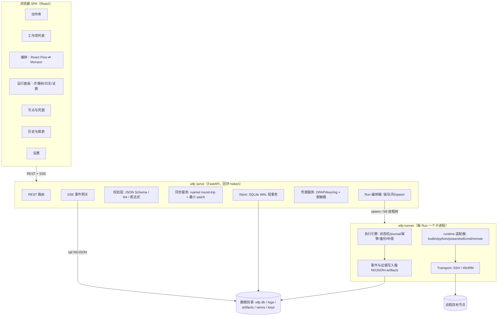
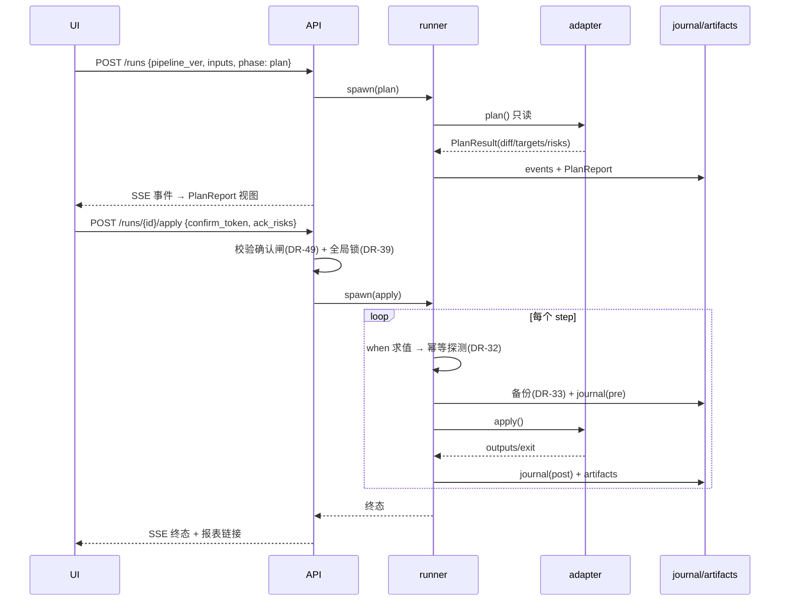

# WFP 架构设计（Architecture Design）

> 配套 `requirements-spec.md`（需求真源）。本文每个设计决策都回指 DR/RA/MD 编号；**架构不引入未被 DR 覆盖的能力**。
> 版本 v1.0 ｜ 2026-11-15 ｜ 状态：待实现团队评审

---

## 1. 设计目标与质量属性驱动

| 质量属性 | 具体目标（来源 DR） | 架构手段 |
| --- | --- | --- |
| 正确性可证明 | plan 零副作用（DR-30）、参数强校验（DR-14） | 契约优先 + 只读 plan 实现 + JSON Schema 双端校验 |
| 可回退 | apply 前置备份、逆序补偿（DR-33/34） | journal + 内容寻址备份 + 步骤级 compensate |
| 可控 | 取消 10s 内进程树清空（DR-35） | 独立 runner 进程 + Job Object/killpg |
| 可信 | 凭据零明文（DR-52/53） | DPAPI + env 注入 + 全链路脱敏器 |
| 低编排成本 | YAML 真源、图为视图（DR-45） | 最小 patch + ruamel round-trip + 布局分离 |
| 不丢证据 | 日志 5000 行/s 落盘不丢（DR-61/38） | NDJSON 追加写 + SSE 背压 + UI 节流 |
| 单机轻量 | 无外部依赖服务（C-04） | SQLite(WAL) + 文件系统 + 单 API 进程 |
| 可离线 | 断网可装可用（DR-07/73） | 前端产物内嵌 + wheelhouse |

**架构总原则**：*契约在前，实现在后；文本为真源，图为投影；副作用先备份，取消可杀树。*

---

## 2. 关键方案比选与决策记录（ADR）

> 对应过程动作"Creating models to investigate possible strategies"。每个 ADR 给出候选、判据、结论、代价。

### ADR-01 编排真源：YAML-first vs Graph-first vs 双真源
- 候选：A 图为主（图存 DB，导出 YAML）；B YAML 为主（图为投影）；C 双真源双向合并。
- 判据：客户明确指出拖拽麻烦、核心是逻辑（IR-05）；注释/键序必须保真（IR-21）；实现复杂度与失信风险（RA-09）。
- **结论：B**。YAML 文本唯一真源，图是投影，布局独立文件。C 会引入合并冲突与语义漂移，拒绝。
- 代价：图不能表达 YAML 之外的语义（MD-05 约束）；需要投入 round-trip 无损测试（DR-47）。
- 影响 DR：45,46,47,43,44。

### ADR-02 动作实现：全部脚本化 vs 统一契约 + 混合实现
- 候选：A 所有动作都是一次脚本调用（客户设想 IR-06）；B builtin 进程内 + 脚本子进程 + 远程通道，统一 manifest 契约。
- 判据：真干跑与结构化 diff（RA-02/03）、启动开销（DR-70 <20ms）、依赖隔离（RA-12）、既有脚本复用（IR-10）。
- **结论：B**。**统一的是契约，不是实现**。理由：`plan` 要零副作用地算 diff，脚本无法被信任地"半执行"；builtin 用只读代码路径可证明零副作用。
- 代价：内置动作需自研维护（DR-19 清单）；契约套件必须严格（DR-18）。
- 影响 DR：10,11,12,15,19,30。

### ADR-03 执行进程模型：线程 / API 内子进程 / 独立 runner
- 候选：A 线程池；B API 进程内 subprocess；C 每个 Run 一个独立 `wfp-runner` 子进程。
- 判据：取消要杀干净（RA-06）、崩溃隔离（DR-71）、venv 依赖隔离（RA-12）、UI 不被阻塞（RA-10）。
- **结论：C**。API 只做编排与读写短事务；runner 承载执行，stdout/事件通过 NDJSON + 本地管道/文件回传。
- 代价：进程间通信与状态同步复杂度；需要锁与 PID 校验（DR-39）。
- 影响 DR：35,36,39,71。

### ADR-04 远程实现：Fabric vs paramiko vs pypsrp vs 系统 ssh
- 候选：A Fabric（高层，面向 Linux/POSIX）；B paramiko 直用（exec + SFTP，可控超时/取消）；C pypsrp（WinRM，Windows 目标）；D 调用系统 `ssh/scp`。
- 判据：需要 Windows 目标（MD-07）、细粒度取消与超时（DR-58/59）、原子替换与 hash（DR-55）、不依赖外部二进制（DR-73）。
- **结论：B + C 双适配器**，`Transport` 抽象接口；**Fabric 仅作可选兼容层**（用户既有 fabfile 迁移），不作核心依赖。拒绝 D：系统 ssh 的取消/密码注入/跨平台行为不可控。
- 代价：两套语义差异需能力探测与降级矩阵（MD-07）。
- 影响 DR：54,55,56,57,58,59。

### ADR-05 存储：SQLite + 文件系统（日志/证据/实现体）
- 结论：元数据/审计/journal 入 SQLite（WAL）；日志与证据入文件系统（内容寻址），DB 只存索引与哈希。
- 理由：避免日志洪流写爆 DB（RA-10）；证据可直接下载与打包。
- 影响 DR：38,61,69,71,79。

### ADR-06 前端交付：Vite + React + TS，产物内嵌 Python 包
- 结论：单页应用，构建产物放 `wfp/web/dist`，由 FastAPI `StaticFiles` 托管；无 CDN。
- 理由：DR-07/73 离线；单机部署简单。
- 影响 DR：07,40,44,48。

### ADR-07 凭据加密：DPAPI 优先，AES-GCM 兜底
- 结论：Windows 用 `CryptProtectData`（当前用户 scope，via `pywin32`/`ctypes`）；非 Windows 或不可用时用 `keyring`；再兜底 AES-256-GCM + 主口令（Argon2id 派生）。
- 理由：单机单用户下 DPAPI 免口令且与用户绑定（OQ-07 默认）。
- 代价：换机/换用户不可解密 → 导出默认不含凭据（DR-05）。
- 影响 DR：52,53,68。

### ADR-08 实时通道：SSE（单向）+ REST（控制）
- 结论：日志与事件用 SSE（`Last-Event-ID` 续传），控制走 REST。拒绝 WebSocket：无需双向高频，SSE 更易续传与代理。
- 影响 DR：61,60,64。

### ADR-09 AI 辅助：可选草案生成器 + 四道闸
- 结论：provider 可插拔默认关闭；生成 → schema → lint → 人工接受 → plan 确认。AI 永不直接触发 apply。
- 影响 DR：80,81,82,83。

### ADR-10 调度与触发：本轮不做
- 结论：不引入常驻调度器；`wfp run` 可被外部任务计划程序调用（提供退出码契约 DR-09），把调度外包给 OS。
- 影响：OS-02；未来若需内置调度，新增 runner 常驻模式与 DR-84+。

### ADR-11 干跑实现：契约式 plan，而非"执行一遍再回滚"
- 结论：`plan()` 是**独立的只读代码路径**；无 plan 实现的动作标 `unpredictable` 且绝不执行。
- 理由：RA-03；"执行再回滚"违背零副作用承诺。
- 影响 DR：17,30,31,49。

### ADR-12 幂等策略：期望态探测 + 内容指纹
- 结论：声明式期望态（文件存在/哈希/配置键值/远端 hash）+ 幂等键入 journal；不做"通用副作用撤销"。
- 理由：RA-04；通用幂等不可判定，必须由动作作者声明。
- 影响 DR：17,32,37。

---

## 3. 系统架构

### 3.1 组件视图



### 3.2 进程与职责边界（MD-08 / ADR-03）

| 进程 | 职责 | 禁止做的事 |
| --- | --- | --- |
| `wfp serve`（API） | 鉴权、CRUD、校验、lint、YAML 同步、锁与队列、spawn/kill runner、SSE tail | 不执行业务动作；不持长事务；不阻塞事件循环 |
| `wfp-runner`（每 Run 一个） | 执行状态机、动作调用、备份/补偿、写 journal 与证据 | 不直接对外提供 HTTP；不改元数据表（只写 run 相关表） |
| 动作子进程 | python/ps/cmd 实现体 | 不接触凭据明文以外的密钥材料；stdin 关闭 |

### 3.3 数据目录布局（DR-05）

```
%LOCALAPPDATA%\WFP\            # 或 $WFP_HOME
├─ wfp.db                      # SQLite(WAL): 元数据/审计/journal/run
├─ wfp.db-wal / -shm
├─ config.toml                 # 端口/并发/保留策略/AI 开关（无凭据）
├─ keys\                       # DPAPI 包装的 DEK 或 Argon2 参数（无明文）
├─ impl\ab\cd\<sha256>.py      # 动作实现体，内容寻址
├─ pipelines\<id>\<ver>\
│   ├─ pipeline.yaml           # 真源（含注释）
│   └─ pipeline.layout.json    # 布局，语义无关（DR-46）
├─ venvs\<req-fingerprint>\    # 依赖隔离（DR-15）
├─ wheelhouse\                 # 离线依赖
├─ logs\<run_id>\events.ndjson # 事件流（DR-38/61）
├─ artifacts\<run_id>\...      # 备份/diff/校验报告（DR-63）
└─ backups\wfp-<ts>.db         # 迁移前自动备份（DR-08）
```

### 3.4 代码分层与目录（DR-74）

```
wfp/
├─ cli.py                 # DR-04/09 入口
├─ api/                   # 路由、鉴权、SSE（DR-01/02/72/61）
├─ contracts/             # manifest/pipeline schema、校验、lint（DR-11/14/20/29）
├─ engine/
│   ├─ scheduler.py       # 顺序/分支/循环/子调用（DR-20/21/22）
│   ├─ phases.py          # plan/apply/compensate（DR-30/33/34）
│   ├─ idempotency.py     # 期望态探测与幂等键（DR-32）
│   ├─ journal.py         # 只追加日志与恢复（DR-37/38）
│   ├─ cancel.py          # Job Object / killpg（DR-35）
│   └─ expr.py            # 安全表达式 + Jinja2 沙箱（DR-23/25）
├─ actions/               # builtin 实现 + 契约套件（DR-19/18）
├─ runtimes/              # builtin/python/powershell/cmd/remote（DR-12/15/36）
├─ transport/             # ssh.py / winrm.py / fake.py（DR-54…59, DR-75）
├─ store/                 # SQLite、迁移、审计（DR-08/68/71）
├─ sync/                  # ruamel round-trip + 最小 patch（DR-45/46/47）
├─ security/              # 凭据加解密、脱敏器（DR-52/53）
└─ web/dist/              # 前端产物（DR-07）
```

---

## 4. 动作契约与 runtime 适配器

### 4.1 manifest 字段（规范：`schemas/action-manifest.schema.json`）

| 字段 | 类型 | 说明 | DR |
| --- | --- | --- | --- |
| `id` | string `^[a-z][a-z0-9_.]*$` | 稳定标识，如 `config.edit` | 10 |
| `version` | semver | 不可变版本 | 16 |
| `name/description/category/tags` | string/array | 展示与检索 | 13 |
| `runtime` | enum | `builtin\|python\|powershell\|cmd\|remote` | 12 |
| `entry` | object | builtin: `module:func`；python: `script.py` + `argv`/`callable`；ps/cmd: 命令模板；remote: `transport` + 命令/操作 | 12/14 |
| `params` | JSON Schema | 参数契约（支持 `templatable` 标注） | 14/23 |
| `outputs` | JSON Schema | 结构化输出（供 `register` 引用） | 23 |
| `capabilities` | object | `dry_run/idempotent/compensate/needs_admin/needs_network/side_effects` | 17 |
| `policy` | object | `timeout/retry/console/stdin` | 26/36 |
| `plan.entry` | object? | 干跑入口（`dry_run: plan` 时必填） | 30 |
| `compensate.entry` | object? | 补偿入口（`compensate: supported` 时必填） | 34 |
| `evidence` | array | 声明产出的证据类型（diff/backup/report/transfer） | 38/63 |
| `ui` | object | rjsf uiSchema、字段控件（path/node/secret 选择器） | 48 |
| `requirements` | array? | python 依赖（用于 venv 指纹） | 15 |

### 4.2 适配器接口（Python 签名，DR-12）

```python
class ActionContext(Protocol):
    params: dict[str, Any]          # 已通过 JSON Schema 校验、模板已求值
    workspace: Path                 # DR-24 相对路径基准
    node: NodeSnapshot | None       # DR-51 运行快照
    secrets: SecretResolver         # DR-53 只回引用，不落日志
    emit: Callable[[Event], None]   # DR-38 结构化事件
    artifact: ArtifactWriter        # DR-33/63 证据与备份
    cancel: CancelToken             # DR-35 协作式取消（builtin 必须轮询）
    deadline: float                 # DR-26 单调时钟截止时间

class RuntimeAdapter(Protocol):
    def prepare(self, ctx: ActionContext) -> Prepared: ...
    def plan(self, ctx: ActionContext) -> PlanResult: ...       # 必须零副作用（DR-30）
    def apply(self, ctx: ActionContext) -> ApplyResult: ...     # 前置备份由引擎统一编排（DR-33）
    def compensate(self, ctx: ActionContext, receipt: ApplyReceipt) -> None: ...
    def cancel(self, handle: Handle) -> None: ...               # 3s 温和 / 10s 强杀（DR-35）
```

**统一约定**
- 退出码：0 成功；非 0 失败；`stdout` 末尾一行 `WFP_OUTPUT::{json}` 携带结构化 outputs（脚本动作的"入口契约"，解决 IR-14）。
- 取消：builtin 轮询 `ctx.cancel`；子进程 Job Object/killpg；remote 关通道 + 远端终止（DR-59）。
- 脱敏：所有 emit/artifact 写入前经 `Redactor`（DR-53），无例外路径。

### 4.3 内置动作与能力矩阵（DR-19）

| 动作 | runtime | dry_run | idempotent | compensate | side_effects | 备注 |
| --- | --- | --- | --- | --- | --- | --- |
| `archive.extract` | builtin | plan | yes | supported | local_fs | 解压前列清单；已存在同名文件先备份 |
| `archive.pack` | builtin | plan | yes | supported | local_fs | 备份用 |
| `fs.copy` / `fs.move` | builtin | plan | yes | supported | local_fs | move 补偿为反向 move |
| `fs.delete` | builtin | plan | yes | supported | destructive | 删除前必须打包备份（DR-33） |
| `config.edit` | builtin | plan | yes | supported | local_fs | json/yaml/ini；yaml 用 ruamel 保注释；产出行级 diff |
| `net.upload` / `net.download` | builtin | plan | conditional | manual | remote_fs | HTTP(S)/SMB；hash 幂等 |
| `assert.file_exists` | builtin | plan | yes | none | none | 失败默认终止（IR-15） |
| `assert.checksum` | builtin | plan | yes | none | none | sha256/md5 |
| `assert.json_schema` | builtin | plan | yes | none | none | 配置结构校验 |
| `script.local` | python/powershell/cmd | plan\|none | 作者声明 | 作者声明 | 作者声明 | 客户既有脚本入口（IR-14） |
| `remote.exec` | remote | plan\|none | 作者声明 | manual/none | remote_exec | plan 仅在声明只读命令时可预测 |
| `remote.upload` / `remote.download` | remote | plan | yes | supported | remote_fs | 目录递归 + hash 跳过（DR-56） |
| `remote.config_edit` | remote | plan | yes | supported | remote_fs | 拉取→改→备份→原子替换→校验（DR-55） |

---

## 5. 执行引擎设计

### 5.1 Run 生命周期时序（apply）



### 5.2 调度算法（DR-20/21/22）

```python
def execute_steps(steps, scope, phase):
    for step in steps:                      # 顺序语义 = 列表顺序（不是图拓扑）
        if not eval_when(step.when, scope): # DR-25 安全求值
            emit(skipped_condition); continue
        for item, idx in expand_loop(step.loop, scope):   # DR-21 有界
            child = scope.push(item=item, index=idx)
            run_one(step, child, phase)     # 重试/超时/错误策略在 run_one 内
```

- **顺序即列表顺序**：图上的连线只是顺序的可视化，避免"图拓扑 vs YAML 顺序"双语义（ADR-01 的直接后果）。
- 并行：本轮不做（OS-03）；`parallel` 关键字保留但不实现，lint 报 warning。
- 子调用：加载期展开为子步骤树，深度 ≤5，环检测（DR-22）。

### 5.3 幂等与备份（DR-32/33）

```
desired_state_fingerprint = hash(目标标识 + 期望内容/键值)
idempotency_key = sha256(action_ref | resolved_params | target_identity | desired_state_fingerprint)

apply 前：
  if capability.idempotent in {yes, conditional} and probe_desired_state():
      journal(skipped_idempotent, key); return
  if side_effects != none:
      receipt = backup(targets)        # 本地 copy / 远端拉回；sha256 记账
      journal(pre_apply, receipt_id)
```

补偿逆序读取 `journal` 中 `pre_apply` 的 receipt，逐个还原并校验哈希（DR-34/79）。

### 5.4 取消与超时（DR-35/36/59）

| 层 | 机制 | 时限 |
| --- | --- | --- |
| builtin | `CancelToken` 协作轮询（长循环每 100ms 检查） | 3s 内退出 |
| 子进程（Windows） | Job Object（`KILL_ON_JOB_CLOSE`）+ `psutil` 递归 terminate→kill | 3s terminate / 10s kill |
| 子进程（POSIX） | `setsid` + `killpg(SIGTERM)`→`SIGKILL` | 同上 |
| PowerShell | `-NonInteractive -NoProfile`，stdin 关闭 | 同上 |
| remote | 关通道 + 远端 `kill`/`Stop-Process`；不可确认 → needs_attention | 通道 5s |

### 5.5 崩溃恢复（DR-37）

1. 启动时扫描 `runs.status in {running, cancelling}` 且 runner PID 不存在 → 置 `interrupted`。
2. `resume` 读取 journal 最后一致点，重建 scope（outputs 来自 journal）。
3. 幂等步骤自动重放；`idempotent: no` 的步骤要求 `--confirm-step <id>`。
4. 锁自愈：文件锁含 PID + 启动时间，PID 不存在或超过 30s 心跳缺失即释放（DR-39）。

---

## 6. 参数、模板与路径解析

### 6.1 求值管线（DR-14/23/24/25）

```
YAML with → 变量解析(作用域链) → Jinja2 沙箱渲染(仅 templatable 字段)
          → secret() 引用解析(不落地) → JSON Schema 今日校验 → 路径规范化 → 冻结为 resolved_params
```

- 作用域链：`step.outputs > inputs > node > vars > env(白名单)`（DR-23）。
- 沙箱：`jinja2.sandbox.SandboxedEnvironment`，禁用 `__*` 访问；自定义过滤器仅白名单（`basename/dirname/joinpath/to_json/quote`）。
- 表达式（`when/while`）：**不用 Jinja 执行逻辑**，用独立受限 AST 求值器（`ast.parse` + 节点白名单），50ms 超时（DR-25）。
- 路径：`resolve(path, base=workspace)`；`remote:` 前缀 → 远端路径对象；越界检查 `os.path.commonpath`（DR-24）。
- 冻结：`resolved_params` 与其哈希写入 journal，用于幂等键与复现（DR-32/65）。

### 6.2 凭据解析（DR-53）

```
with:
  password: "{{ secret('node.prod.root') }}"   # 只有引用，YAML 中永无明文
```
解析结果为 `SecretStr` 对象：`__str__` 返回 `***`；仅在适配器注入点 `.reveal()`；注入方式为子进程 env 或 0600 临时文件（用后 `shred` 尽力而为）。`Redactor` 在 emit/artifact/异常格式化三处强制过滤，含 URL-encoded 与 base64 变体。

---

## 7. 远程层设计（DR-54…DR-59）

### 7.1 Transport 抽象

```python
class Transport(Protocol):
    kind: Literal["ssh", "winrm"]
    caps: Capabilities                       # MD-07 探测结果
    def exec(self, cmd: str, timeout: float, sudo: bool=False) -> ExecResult: ...
    def put(self, local: Path, remote: str, mode: int|None=None) -> TransferReceipt: ...
    def get(self, remote: str, local: Path) -> TransferReceipt: ...
    def stat(self, remote: str) -> RemoteStat | None: ...
    def hash(self, remote: str, algo="sha256") -> str | None: ...
    def atomic_write(self, remote: str, data: bytes, backup: bool=True) -> WriteReceipt: ...
    def close(self) -> None: ...
```

- SSH：`paramiko.SSHClient` + `SFTPClient`；`exec_command(timeout=...)`，`get_pty=False`（避免交互）；keepalive 15s。
- WinRM：`pypsrp.Client` + `PSRP` PowerShell runspace；文件传输用分块 base64（大文件走打包 + 分块校验）。
- 会话池：按 `(node_id, run_id)` 复用，空闲 60s 回收（DR-58）；同一节点串行（DR-39）。
- 错误分类：`DNS / REFUSED / AUTH / TIMEOUT / PRIV / CAP_MISSING / TRANSFER_HASH`，映射到 `WFP-E-*`（DR-58）。

### 7.2 远端配置编辑事务（DR-55）

```
1 get(remote)  → local temp（plan 阶段止于此 + diff）
2 结构化修改：json（保序）/ yaml（ruamel 保注释）/ ini（configparser 保大小写）
3 远端备份：cp remote → remote.wfp-bak-<runid>（并 get 回本地 artifacts）
4 put(local_new) → remote.wfp-tmp-<runid>
5 hash(tmp) == hash(local_new) ? 否 → 删 tmp 并失败
6 atomic rename(tmp → remote)（同分区保证原子）
7 hash(remote) 校验；失败 → 用步骤 3 备份回滚
```
换行/编码：读取时探测原文件 BOM/CRLF，写出时保持一致（RA-08）。

### 7.3 目录传输（DR-56）

- 遍历本地目录 → include/exclude glob 过滤 → 逐文件 `hash` 比对（远端缺失或不同才传）。
- 大目录可选"打包传输"：本地 tar → put → 远端解包（能力探测支持时启用），减少往返。
- 进度事件：每文件或每 4MB 发 `transfer.progress`；失败按文件重试（默认 2 次）。
- 幂等：全部命中 → 步骤 `skipped_idempotent`（DR-32）。

---

## 8. 事件、日志与证据（DR-38/61/62/63）

### 8.1 事件 schema（NDJSON，版本化）

```json
{"v":1,"seq":1024,"ts":"2026-11-15T10:12:33.123+08:00","run":"r-01H...","step":"s6","attempt":1,
 "type":"step.stdout","payload":{"chunk_id":12,"text":"uploading app.jar\n","stream":"stdout"}}
```

| 事件类型 | 说明 |
| --- | --- |
| `run.started/finished` | 阶段、输入快照哈希、节点快照 |
| `step.started/finished/skipped` | 状态、跳过原因（condition/idempotent）、耗时 |
| `step.stdout/stderr` | 分片文本（≤64KB/片），带 chunk_id |
| `step.retry/timeout/cancel` | 控制与异常 |
| `plan.report` | PlanReport 引用 |
| `artifact.created` | kind/path/sha256/bytes |
| `backup.created/restored` | 补偿依据 |
| `transfer.progress` | 传输进度 |
| `attention.required` | 需人工介入清单 |

### 8.2 流式管道与背压

```
动作 stdout → runner 读取线程 → Redactor → NDJSON 追加写(fsync 策略) → SSE tail(Last-Event-ID)
                                              ↓
                                        UI 环形缓冲 + 20fps 合并渲染 + 虚拟滚动
```
- **落盘优先**：SSE 慢客户端不影响落盘；UI 断线重连按 `Last-Event-ID` 补齐（DR-61）。
- 配额：单 run 200MB / 单动作 100MB，超限截断并 emit warning（DR-77）。
- 证据：`artifacts` 表存索引 + sha256，文件在 `artifacts/<run_id>/`；zip 导出含清单（DR-63/78）。

---

## 9. 双视图同步详细设计（DR-45 / DR-46 / DR-47）★

> 这是本项目最容易失信的模块，单列一章并设阻塞门禁。

### 9.1 数据结构

```python
@dataclass
class YamlDoc:                  # 真源包装
    text: str                   # 原始文本（含注释/CRLF/引号风格）
    doc: CommentedMap           # ruamel round-trip 树
    text_sha: str               # 冲突检测用

@dataclass
class GraphModel:               # 投影（只读派生）
    nodes: list[Node]           # step 节点 / 容器节点（branch/loop）
    edges: list[Edge]           # 仅表达顺序
    index: dict[str, Path]      # step_id → doc tree 路径（如 steps[3].with.path）

@dataclass
class Layout:                   # 语义无关，独立文件
    positions: dict[str, XY]
    collapsed: set[str]
    groups: dict[str, list[str]]
    viewport: dict
```

### 9.2 图 → YAML：最小 patch 算法

```python
def graph_edit_to_patch(delta: GraphDelta, y: YamlDoc) -> list[Patch]:
    patches = []
    match delta.kind:
        case "update_param":     # 表单/属性面板改字段
            p = y.index[delta.step_id] + ["with", delta.field]
            if get(y.doc, p) != delta.value:            # 无变化不产 patch（防抖动循环）
                patches.append(Replace(p, delta.value))
        case "insert_step":
            i = insertion_index(delta.after_step_id)     # 顺序 = 列表顺序
            patches.append(Add(["steps", i], new_step_map(delta)))
        case "remove_step":
            patches.append(Remove(["steps", index_of(delta.step_id)]))
        case "move_step":        # 拖拽改顺序
            patches.append(Move(["steps", src], ["steps", dst]))
        case "wrap_container":   # 加分支/循环
            patches.append(Replace(["steps", i, "when"], expr))   # 或 loop 字段
    assert all(is_step_scoped(p) for p in patches)       # 铁律 2：只许触及 steps[i]
    return patches
```

**写回规则（保真关键）**
1. 只对 `CommentedMap/CommentedSeq` 做**就地**增删改，**绝不** `doc = yaml.load(dump(doc))` 重建。
2. 新增节点用 `CommentedMap`，键序按 schema 规范序（`id, uses, with, when, ...`）；缩进沿用 `ruamel` 从原文推断的 `best_map_indent/best_sequence_indent`。
3. 保留原 `yaml.preserve_quotes = True`、`yaml.width` 设为原文最大行宽（避免自动折行）、`yaml.map_indent/sequence_indent/offset` 从原文探测。
4. 换行：探测原文主导换行符，dump 后统一还原（CRLF 文件不被改成 LF）。
5. 删除 step 时同时删除其**紧邻前置注释块**（归属判定：注释与上一节点之间无空行则归属该节点），避免注释悬挂。
6. `Move` 用 `CommentedSeq` 的切片重排并搬运 `ca`（comment attribute），保证注释随节点移动。

### 9.3 YAML → 图：投影

```python
def project(y: YamlDoc) -> GraphModel:
    doc = ruamel_roundtrip_load(y.text)      # 失败 → 保留上一版图 + 报错标记，不清空画布
    steps = doc["steps"]
    nodes = [step_node(s) for s in steps] + [container_nodes(s) for s in steps if s.get(("when","loop"))]
    edges = sequential_edges(nodes)
    return GraphModel(nodes, edges, build_index(steps))
```
- 解析失败（用户正在输入）时**不清空图**，仅显示"YAML 语法错误"横幅（避免编辑抖动）。
- 图节点 id 恒等于 `step.id`；缺失 id 时按 `steps[i]` 生成临时 id 并提示补全（不自动写回，避免意外 patch）。

### 9.4 同步状态机与防抖（DR-45）

```
IDLE ──graph edit──> PATCHING ──apply patch+dump──> DIRTY_TEXT ──(set text)──> PROJECTING ──> IDLE
IDLE ──yaml edit───> DEBOUNCE(300ms) ──parse──> PROJECTING ──> IDLE
冲突：若 PATCHING 时发现 text_sha 已被 YAML 侧改动 → 放弃本次 patch，以真源为准 + Toast 提示
回声抑制：由 patch 产生的 text 变更打 origin=graph 标记，投影时不再触发反向 patch
```

### 9.5 布局分离（DR-46）

- 布局写入 `pipeline.layout.json`，**与 YAML 保存解耦**（独立防抖 1s，失焦即存）。
- 关联键 = `step.id`；step 删除 → 清理对应布局项；新增 step → 自动布局增量放置（不重排既有节点）。
- 删除 layout 文件 → 用 dagre 重排，执行语义完全不变（门禁 QC-46 断言）。

### 9.6 无损门禁测试设计（DR-47 / G3）

| 维度 | 设计 |
| --- | --- |
| 语料 | ≥200 份：注释（行首/行尾/块）、锚点与别名、单双引号混合、CRLF/LF、中文与 emoji、长行、空行、缩进 2/4、流式集合、多层嵌套 |
| 属性 1 | `dump(load(text)) == text`（未编辑时字节级相等） |
| 属性 2 | 任意长度随机图操作序列后，非目标字段区域字节级不变（用 diff 区域断言） |
| 属性 3 | 撤销 N 步后回到初始文本（字节级） |
| 属性 4 | 双向同步无不动点漂移：`project(patch(project(text)))` 稳定 |
| 工具 | Hypothesis（shrinking 输出最小反例）+ 语料快照回归 |
| 门禁 | CI `G3` 阻塞；反例归档 `docs/gates/G3/`；失败禁止发布（客户指定 IR-21） |

---

## 10. 数据模型（SQLite DDL 草案，DR-08/10/28/50/52/65/68/71）

```sql
PRAGMA journal_mode=WAL; PRAGMA synchronous=NORMAL; PRAGMA foreign_keys=ON;
PRAGMA busy_timeout=3000;

CREATE TABLE schema_version(version INTEGER NOT NULL, applied_at TEXT NOT NULL);

CREATE TABLE action(
  id TEXT PRIMARY KEY, name TEXT NOT NULL, category TEXT, tags TEXT,          -- JSON array
  latest_version TEXT NOT NULL, deleted INTEGER NOT NULL DEFAULT 0,
  created_at TEXT NOT NULL, updated_at TEXT NOT NULL);

CREATE TABLE action_version(
  action_id TEXT NOT NULL REFERENCES action(id), version TEXT NOT NULL,
  manifest_json TEXT NOT NULL, runtime TEXT NOT NULL,
  impl_path TEXT NOT NULL, impl_sha256 TEXT NOT NULL,
  cap_dry_run TEXT NOT NULL, cap_idempotent TEXT NOT NULL, cap_compensate TEXT NOT NULL,
  needs_admin INTEGER NOT NULL, needs_network INTEGER NOT NULL, side_effects TEXT NOT NULL,
  req_fingerprint TEXT, created_at TEXT NOT NULL,
  PRIMARY KEY(action_id, version));                                          -- INV-01 不可变

CREATE TABLE pipeline(
  id TEXT PRIMARY KEY, name TEXT NOT NULL, latest_version TEXT NOT NULL,
  status TEXT NOT NULL DEFAULT 'active',                                     -- active|draft(DR-82)
  deleted INTEGER NOT NULL DEFAULT 0, created_at TEXT NOT NULL, updated_at TEXT NOT NULL);

CREATE TABLE pipeline_version(
  pipeline_id TEXT NOT NULL REFERENCES pipeline(id), version TEXT NOT NULL,
  yaml_path TEXT NOT NULL, yaml_sha256 TEXT NOT NULL, layout_path TEXT,
  inputs_schema_json TEXT, step_count INTEGER NOT NULL,
  deps_json TEXT NOT NULL,                                                   -- [{action_id,version}]
  created_at TEXT NOT NULL, PRIMARY KEY(pipeline_id, version));

CREATE TABLE node(
  id TEXT PRIMARY KEY, name TEXT NOT NULL, host TEXT NOT NULL, port INTEGER NOT NULL,
  os_kind TEXT NOT NULL, username TEXT NOT NULL, auth_kind TEXT NOT NULL,
  credential_id TEXT REFERENCES credential(id), description TEXT, tags TEXT,
  default_workdir TEXT, caps_json TEXT, last_probe_at TEXT, created_at TEXT NOT NULL);

CREATE TABLE credential(
  id TEXT PRIMARY KEY, kind TEXT NOT NULL,                                   -- password|key|token
  label TEXT NOT NULL, scheme TEXT NOT NULL,                                 -- dpapi|keyring|aesgcm
  ciphertext BLOB NOT NULL, meta_json TEXT, created_at TEXT NOT NULL);       -- INV-05 永不出库

CREATE TABLE run(
  id TEXT PRIMARY KEY, pipeline_id TEXT NOT NULL, pipeline_version TEXT NOT NULL,
  phase TEXT NOT NULL, status TEXT NOT NULL,                                 -- MD-03
  trigger TEXT NOT NULL,                                                     -- ui|cli
  inputs_json TEXT NOT NULL, node_snapshot_json TEXT, action_versions_json TEXT NOT NULL,
  plan_report_path TEXT, confirm_json TEXT,                                  -- DR-49 确认闸
  runner_pid INTEGER, heartbeat_at TEXT,
  started_at TEXT NOT NULL, finished_at TEXT, error_code TEXT);

CREATE TABLE step_run(
  id TEXT PRIMARY KEY, run_id TEXT NOT NULL REFERENCES run(id),
  step_id TEXT NOT NULL, iteration INTEGER NOT NULL DEFAULT 0, attempt INTEGER NOT NULL DEFAULT 1,
  action_id TEXT NOT NULL, action_version TEXT NOT NULL,
  status TEXT NOT NULL, skip_reason TEXT, idempotency_key TEXT,
  resolved_params_sha256 TEXT, exit_code INTEGER, outputs_json TEXT,
  log_offset_start INTEGER, log_offset_end INTEGER,
  started_at TEXT, finished_at TEXT);
CREATE INDEX idx_step_run_run ON step_run(run_id, step_id);
CREATE INDEX idx_idem ON step_run(idempotency_key, status);

CREATE TABLE journal(                                                        -- INV-04 只追加
  seq INTEGER PRIMARY KEY AUTOINCREMENT, run_id TEXT NOT NULL, step_run_id TEXT,
  event TEXT NOT NULL, payload_json TEXT NOT NULL, ts TEXT NOT NULL);
CREATE INDEX idx_journal_run ON journal(run_id, seq);

CREATE TABLE artifact(
  id TEXT PRIMARY KEY, run_id TEXT NOT NULL, step_run_id TEXT,
  kind TEXT NOT NULL,                                                        -- backup|diff|report|transfer|log
  path TEXT NOT NULL, sha256 TEXT NOT NULL, bytes INTEGER NOT NULL,
  source_target TEXT, created_at TEXT NOT NULL);                             -- DR-79

CREATE TABLE audit(                                                          -- DR-68 只追加
  seq INTEGER PRIMARY KEY AUTOINCREMENT, ts TEXT NOT NULL, actor TEXT NOT NULL,
  action TEXT NOT NULL, target TEXT, before_sha256 TEXT, after_sha256 TEXT, detail_json TEXT);
CREATE TRIGGER audit_no_update BEFORE UPDATE ON audit BEGIN SELECT RAISE(ABORT,'audit is append-only'); END;
CREATE TRIGGER audit_no_delete BEFORE DELETE ON audit BEGIN SELECT RAISE(ABORT,'audit is append-only'); END;

CREATE TABLE setting(key TEXT PRIMARY KEY, value_json TEXT NOT NULL, updated_at TEXT NOT NULL);
CREATE TABLE singleton_lock(name TEXT PRIMARY KEY, holder_pid INTEGER, holder_run TEXT, acquired_at TEXT, heartbeat_at TEXT);
```

**写路径约束（DR-71）**：单写队列（asyncio 队列 + 专用写线程），事务 <50ms；日志不入表；`journal` 批量提交（每 20 条或 200ms）。

---

## 11. API 设计（REST + SSE，DR-01/02/09/61/72）

| 方法 | 路径 | 说明 | DR |
| --- | --- | --- | --- |
| GET | `/api/health` | 健康与版本 | 01 |
| GET | `/api/actions` / POST | 列表（搜索/分类）/ 创建 | 13 |
| GET/PUT/DELETE | `/api/actions/{id}` | 详情 / 新版本 / 软删 | 10,13 |
| GET | `/api/actions/{id}/versions/{v}` | manifest + impl（只读） | 03,16 |
| POST | `/api/actions/{id}/test` | 契约套件 + 单动作试跑 | 18,41 |
| GET/POST | `/api/pipelines` | 列表 / 创建 | 28 |
| GET | `/api/pipelines/{id}/yaml` | 真源文本 + sha | 45 |
| PUT | `/api/pipelines/{id}/yaml` | 全文保存（带 `If-Match: sha`） | 45 |
| POST | `/api/pipelines/{id}/patch` | **最小 patch**（图编辑专用） | 45 |
| GET/PUT | `/api/pipelines/{id}/layout` | 布局读写 | 46 |
| POST | `/api/pipelines/{id}/lint` | lint 结果（行列定位） | 29 |
| POST | `/api/runs` | 创建 run（`phase: plan\|apply`，inputs） | 30,49 |
| GET | `/api/runs/{id}` | 状态 + 步骤树 | 60 |
| POST | `/api/runs/{id}/apply` | 由 plan 转 apply（需 confirm） | 49 |
| POST | `/api/runs/{id}/cancel\|pause\|resume\|compensate` | 运行控制 | 64 |
| POST | `/api/runs/{id}/steps/{sid}/retry` | 单步重试 | 64 |
| GET | `/api/runs/{id}/events` (SSE) | 事件流，支持 `Last-Event-ID` | 61 |
| GET | `/api/runs/{id}/artifacts` / `/{aid}` | 证据列表 / 下载 | 63 |
| GET | `/api/runs/{id}/report?fmt=md\|html\|csv` | 报表 | 66 |
| GET/POST/PUT/DELETE | `/api/nodes[...]` | 节点 CRUD | 50 |
| POST | `/api/nodes/{id}/probe` | 连接测试与能力探测 | 58 |
| GET/PUT | `/api/context/current-node` | 当前目标节点 | 51 |
| POST/DELETE | `/api/credentials` | 创建/删除（**永不返回密文**） | 52 |
| GET/PUT | `/api/settings` | 设置 | 67 |
| GET | `/api/audit?…` | 审计查询/导出 | 68 |
| POST | `/api/ai/draft` | AI 草案（默认 404） | 80,83 |
| POST | `/api/maintenance/export\|import\|verify\|cleanup` | 迁移/完整性/清理 | 05,69,79 |

**约定**：错误体 `{code:"WFP-E-…", message, path?, details?}`；乐观并发用 `If-Match`（YAML sha）；所有非 GET 需 `X-WFP-Token` + `Origin` 校验（DR-72）。

---

## 12. 前端设计（DR-40…DR-49/60…63）

| 模块 | 技术 | 要点 |
| --- | --- | --- |
| 状态层 | TanStack Query + Zustand | 服务端状态与本地编辑态分离；YAML 文本 sha 作为并发令牌 |
| 图 | React Flow + dagre | 自定义 step 节点（能力徽章/状态色）、容器节点（branch/loop）、只读运行态叠加 |
| 编辑器 | Monaco + yaml worker | 自定义 JSON Schema 校验、lint 标记、`Ctrl+S` 保存、diff 视图 |
| 表单 | rjsf + 自定义 widget | path/node/secret 选择器；与图/YAML 共用 patch 通道（DR-48） |
| 同步 | `syncClient` | 300ms 防抖、origin 标记回声抑制、冲突 Toast（§9.4） |
| 日志 | 虚拟滚动 + 环形缓冲 | 20fps 合并、ANSI 解析、搜索、跟随/暂停、导出（DR-61/62） |
| 运行面板 | 步骤树 + 证据页签 | SSE 驱动，断线按 last-id 补齐；diff 用 monaco diff editor |
| 无障碍/快捷键 | — | 全键盘可达；`Ctrl+Enter` 干跑、`Ctrl+Shift+Enter` 执行（DR-40） |

**性能预算**：200 节点图交互 ≥30fps（DR-70）→ 节点组件 memo 化、拖拽时禁用重投影、布局写入防抖 1s。

---

## 13. 安全设计（DR-52/53/72，单机单用户）

| 威胁 | 对策 | 明确不在防护范围 |
| --- | --- | --- |
| 浏览器 CSRF / DNS rebinding | 本机 token（启动生成，写入 `config.toml` 0600）+ `Origin/Host` 白名单 + SameSite=Strict | 用户主动禁用校验 |
| 局域网误暴露 | 默认回环；`--lan` 必须设口令并审计 | 用户主动 `--lan` 后的网络风险 |
| 凭据泄露（DB/备份/导出） | DPAPI/keyring/AES-GCM；导出默认不含凭据 | 同机管理员权限内存读取 |
| 凭据进日志/命令行 | env/临时文件注入 + Redactor 三处强制过滤 | 动作实现体自行打印密码（契约套件检测并拒绝发布） |
| 表达式注入 | AST 白名单 + Jinja 沙箱 + 超时 | — |
| 路径穿越 | workspace 边界 + 显式开关 | 用户显式允许越界 |
| 供应链 | 锁定依赖 + wheelhouse 哈希校验 | — |

---

## 14. 打包、安装与 CLI（DR-04/05/09/73）

```
pipx install wfp                 # 或 pip install wfp（含前端产物）
wfp doctor                       # 环境自诊断
wfp serve --port 8765 --open     # 启动本机平台
wfp plan  deploy --inputs env=prod --node current
wfp run   deploy --inputs-file prod.yaml --yes    # 跳过交互（仍写审计）
wfp run resume r-01H...
wfp action list / add / test <id>
wfp node add / probe <id>
wfp export --out wfp-backup.zip [--with-credentials]   # 默认不含凭据
```

- 打包：`pyproject.toml` + `hatchling`，前端产物纳入 wheel；提供 `wheelhouse/` 与 `install-offline.ps1`。
- Windows 集成：开始菜单快捷方式（`wfp serve --open`）、可选托盘（`pystray`，M5）。
- 退出码契约见 DR-09，便于外部任务计划程序调用（ADR-10）。

---

## 15. 失败模式与影响分析（FMEA 摘要）

| 失败模式 | 检测 | 影响 | 缓解（DR） | 严重度 |
| --- | --- | --- | --- | --- |
| plan 期间发生写操作 | 契约套件文件系统快照探针 | 干跑承诺失效 | builtin 只读路径 + 契约门禁（30,18） | 高 |
| 取消后孙进程残留 | 进程树扫描 | 目标机脏状态 | Job Object + psutil 兜底（35） | 高 |
| 远端半上传 | hash 校验 | 目标文件损坏 | tmp + 原子 rename + 校验回滚（55,56） | 高 |
| 凭据出现在日志 | Redactor 单测 + grep 探针 | 泄露 | 三处强制过滤 + 契约检查（53,18） | 高 |
| round-trip 丢注释 | 属性测试 | 用户失信 | 最小 patch + G3 阻塞（45,47） | 高 |
| SQLite locked | 错误计数 | UI 卡顿 | WAL + 单写队列 + 短事务（71） | 中 |
| 补偿失败 | 状态机 | 无法回退 | needs_attention + 人工清单 + 证据（34） | 中 |
| 日志洪流 | 速率监控 | UI 卡死 | 落盘优先 + 节流 + 配额（61,77） | 中 |
| 依赖冲突 | venv 指纹 | 动作失败 | per-fingerprint venv（15） | 中 |
| AI 幻觉 | schema/lint | 错误编排 | 四道闸 + draft（80–82） | 中 |
| 磁盘写满 | 水位监控 | 执行中断 | 配额 + 清理 + 拒绝新 apply（69,77） | 中 |

---

## 16. 性能预算（DR-70，基准机 8C/16G/SSD）

| 指标 | 预算 | 测量方式 |
| --- | --- | --- |
| 500 步解析 + lint | <500ms | `tests/perf` 计时 |
| 200 节点图拖拽 | ≥30fps | Playwright + Performance API |
| builtin 调用开销 | <20ms | 空动作 1000 次均值 |
| 子进程动作启动 | <300ms | 含解释器启动（venv 已就绪） |
| 日志吞吐 | 5000 行/s 不丢 | 生成器 + 落盘行数比对 |
| 首屏可交互 | <2s（冷启 <5s） | 本地 Lighthouse |
| 远端单文件上传（10MB，LAN） | <3s | 集成基准 |

---

## 17. DR → 模块映射（供 `--check-code` 校验）

| 模块 | 主要 DR |
| --- | --- |
| `api/` | 01,02,09,61,72 |
| `contracts/` | 11,14,17,20,29 |
| `engine/scheduler.py` | 20,21,22,26 |
| `engine/phases.py` | 30,31,33,34,49 |
| `engine/idempotency.py` | 32 |
| `engine/journal.py` | 37,38,79 |
| `engine/cancel.py` | 35,36,39 |
| `engine/expr.py` | 23,24,25 |
| `actions/` | 18,19 |
| `runtimes/` | 12,15,36 |
| `transport/` | 54,55,56,57,58,59 |
| `store/` | 08,10,28,50,65,68,71 |
| `sync/` | 45,46,47 |
| `security/` | 52,53 |
| `web/` | 03,07,40–44,48,60,62,63 |
| `cli.py` | 04,05,06,09,73,76 |
