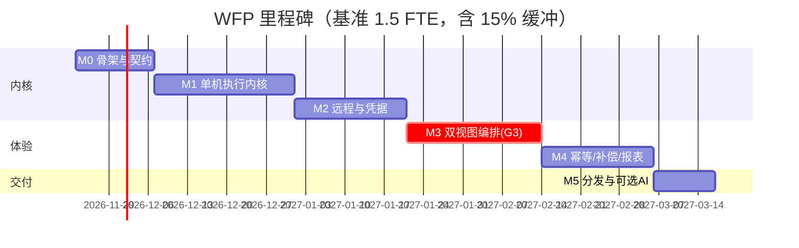
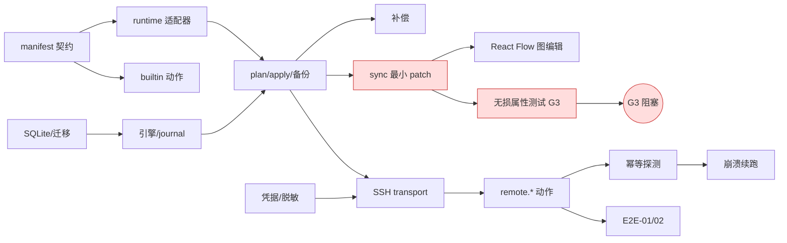

# WFP 实施计划（Implementation Plan）

> 配套 `requirements-spec.md`（DR 真源）与 `architecture-design.md`（ADR/模块）。
> 版本 v1.0 ｜ 2026-11-15 ｜ 计划起点 D0 = 需求签署日

---

## 1. 交付策略

**价值优先顺序**：先把"能一键跑通客户的四个真实场景"做出来（M0→M2，YAML + CLI 即可用），再做"好看的编排"（M3），最后做"省心"（M4 幂等/补偿/报表）与"好装"（M5）。

理由：客户已明确"拖拽过于麻烦，核心是逻辑本身"（IR-05）。因此**不先做图编辑器**，避免把最贵的交互放在最不确定的价值上；图编辑器作为 M3 的可视化增强，且被 G3 无损门禁保护。



> 日期为示意（按 D0=2026-11-23 起算的工作日推算），实际以签署日重排。

### 1.1 里程碑与门禁

| 里程碑 | 主题 | 出口门禁 | 客户可见成果 | 人日 |
| --- | --- | --- | --- | --- |
| **M0** | 骨架与契约 | **G0** | 装得上、打得开、能建动作（含查看/编辑窗口） | 14.0 |
| **M1** | 单机执行内核 | **G1** | 本地动作全通；YAML 工作项可 plan/apply；日志实时；CLI 可跑 | 26.0 |
| **M2** | 远程与凭据 | **G2** | **E2E-01/02 全链路跑通**（客户例 1、例 2）；E2E-03/04 通过 | 21.5 |
| **M3** | 双视图编排 | **G3（含无损阻塞门禁）** | 图 ⇄ YAML 双栏、拖拽编排、表单、运行面板完整版 | 25.5 |
| **M4** | 幂等/补偿/韧性/报表 | **G4** | 二次执行全跳过、失败可回退、崩溃可续跑、历史报表 | 21.5 |
| **M5** | 分发与可选 AI | **G5** | 离线安装包、全局入口、文档、AI 草案（可选） | 11.0 |
| | | | **合计** | **119.5** |

**工期换算**：1.5 FTE（后端 1.0 + 前端 0.5）≈ 16 周，含 15% 缓冲 ≈ **18 周**；2.0 FTE ≈ 12 周，含缓冲 ≈ **14 周**。
**MVP 切线**：M0–M2 = 61.5 人日 ≈ 8.2 周（1.5 FTE），此时客户四个场景已全部可用（YAML + CLI + 最小 UI）。

### 1.2 依赖与关键路径



**关键路径**：契约 → 引擎/plan-apply → sync 最小 patch → **无损属性测试（G3）**。
**最早启动项**：`sync` 模块的语料与属性测试（T3.2）可在 M1 期间并行预研，降低 G3 风险（见 §5 R-01）。

---

## 2. WBS（任务 → DR → 交付物 → 估时）

> 责任列：BE=后端/引擎，FE=前端，QA=测试/合格性，OPS=打包分发。每个任务的 Done 定义见 §4。

### M0 骨架与契约（14.0 人日｜门禁 G0）

| 任务 | 内容 | DR | 责任 | 人日 |
| --- | --- | --- | --- | --- |
| T0.1 | 仓库脚手架、ruff/mypy/pytest、Vite+React+TS、CI 骨架 | 74 | BE+FE | 1.5 |
| T0.2 | SQLite schema + 迁移 + 自动备份 + 单写队列 | 08,71 | BE | 2.0 |
| T0.3 | manifest JSON Schema + 校验 + 能力声明强制 | 11,17 | BE | 1.5 |
| T0.4 | 动作 CRUD API + 实现体内容寻址 + 版本不可变 | 10,13 | BE | 2.0 |
| T0.5 | `wfp serve` + token + Origin 校验 + 静态托管 | 01,02,07,72 | BE | 1.5 |
| T0.6 | 数据目录/`WFP_HOME` + `doctor` + export/import | 05,06 | BE | 2.0 |
| T0.7 | 前端 7 路由骨架 + Monaco 查看/编辑窗口 + diff | 03,40 | FE | 2.5 |
| T0.8 | G0 用例与证据归档 | 全部 M0 DR | QA | 1.0 |

### M1 单机执行内核（26.0 人日｜门禁 G1）

| 任务 | 内容 | DR | 责任 | 人日 |
| --- | --- | --- | --- | --- |
| T1.1 | 执行状态机 + journal + NDJSON 事件写入器 | 38,71 | BE | 3.0 |
| T1.2 | builtin 本地动作（archive/fs/config/assert/net） | 19 | BE | 4.0 |
| T1.3 | python/powershell/cmd 适配器 + venv 指纹隔离 | 12,15,36 | BE | 3.0 |
| T1.4 | plan/apply 两阶段 + PlanReport + 前置备份 | 30,31,33 | BE | 3.0 |
| T1.5 | 取消/超时/进程树 kill（Job Object + killpg） | 35,39 | BE | 2.0 |
| T1.6 | 作用域/模板/安全表达式/路径解析/lint | 23,24,25,29 | BE | 3.0 |
| T1.7 | 工作项 schema + CRUD + 导入导出 + CLI run/plan | 09,20,27,28 | BE | 1.5 |
| T1.8 | SSE 日志流 + 运行面板最小版（步骤树+日志） | 60,61 | FE+BE | 3.0 |
| T1.9 | 契约一致性套件 + FakeTransport/MemoryStore | 18,75 | QA+BE | 2.0 |
| T1.10 | 分支/循环/重试/错误策略 + G1 用例 | 21,26 | BE+QA | 1.5 |

### M2 远程与凭据（21.5 人日｜门禁 G2）

| 任务 | 内容 | DR | 责任 | 人日 |
| --- | --- | --- | --- | --- |
| T2.1 | 凭据服务（DPAPI/keyring/AES-GCM）+ Redactor 三处过滤 | 52,53 | BE | 2.5 |
| T2.2 | 节点 CRUD + 当前目标节点 + 运行快照固化 | 50,51 | BE+FE | 2.0 |
| T2.3 | SSH transport（exec/put/get/stat/hash/atomic_write） | 54 | BE | 3.0 |
| T2.4 | WinRM transport + 能力探测降级 | 54 | BE | 3.0 |
| T2.5 | remote.exec/upload/download + 目录递归与幂等传输 | 19,56 | BE | 3.0 |
| T2.6 | 远端配置编辑事务（备份→tmp→rename→校验→回滚） | 55 | BE | 2.5 |
| T2.7 | 提权/连接测试/超时治理/远端取消清理 | 57,58,59 | BE | 2.0 |
| T2.8 | E2E-01/02/03/04 夹具与 G2 用例 | 19,51,55,56 | QA | 2.5 |

### M3 双视图编排（25.5 人日｜门禁 G3，含阻塞门禁）

| 任务 | 内容 | DR | 责任 | 人日 |
| --- | --- | --- | --- | --- |
| T3.1 | sync 服务：ruamel round-trip + 最小 patch 引擎 + 冲突/回声抑制 | **45** | BE | 4.0 |
| T3.2 | **≥200 语料 + Hypothesis 属性测试（4 条属性）** | **47** | QA+BE | 3.0 |
| T3.3 | React Flow 图编辑（插入/连线/容器/折叠/撤销 50 步） | 44,43 | FE | 4.0 |
| T3.4 | Monaco YAML + schema worker + lint 问题面板跳转 | 29,43 | FE | 2.5 |
| T3.5 | rjsf 参数表单 + path/node/secret widget（同源 patch） | 48,27 | FE | 3.0 |
| T3.6 | 布局分离 `pipeline.layout.json` + dagre 自动布局 | 46 | FE | 1.5 |
| T3.7 | 动作库页 + 工作项列表页完整交互（试跑/一键运行） | 41,42 | FE | 2.5 |
| T3.8 | 运行面板完整版（证据 diff / 输出窗口 / 虚拟滚动） | 62,63,60 | FE | 3.0 |
| T3.9 | 确认闸 UI（风险勾选）+ G3 用例与证据 | 49 | FE+QA | 2.0 |

### M4 幂等 / 补偿 / 韧性 / 报表（21.5 人日｜门禁 G4）

| 任务 | 内容 | DR | 责任 | 人日 |
| --- | --- | --- | --- | --- |
| T4.1 | 期望态探测 + 幂等键 + skipped_idempotent | 32 | BE | 2.5 |
| T4.2 | 逆序补偿 + 备份还原校验 + 人工清单 | 34,79 | BE | 3.0 |
| T4.3 | 崩溃恢复 resume + 锁自愈 + interrupted | 37 | BE | 2.5 |
| T4.4 | 运行控制（暂停/继续/单步重试/手动补偿） | 64 | BE+FE | 2.0 |
| T4.5 | 历史/复现重跑/报表导出（md/html/csv） | 65,66 | BE+FE | 3.0 |
| T4.6 | 设置页 + 审计完整 + 保留清理 + 完整性校验 | 67,68,69,79 | BE+FE | 3.0 |
| T4.7 | 性能基准 + 配额保护 + 诊断包 | 70,77,78 | BE+QA | 2.5 |
| T4.8 | 子工作项调用（深度/环检测） | 22 | BE | 1.5 |
| T4.9 | G4 用例与证据 | 全部 M4 DR | QA | 1.5 |

### M5 分发与可选 AI（11.0 人日｜门禁 G5）

| 任务 | 内容 | DR | 责任 | 人日 |
| --- | --- | --- | --- | --- |
| T5.1 | 离线打包（wheel + 前端产物 + wheelhouse + 安装脚本） | 04,73 | OPS | 2.0 |
| T5.2 | 开始菜单快捷方式 + 可选托盘 | 04 | OPS | 1.0 |
| T5.3 | 文档四件套 + 内置示例库 + 30 分钟上手验收 | 76 | BE+QA | 2.5 |
| T5.4 | AI provider + 四道闸（Should，可裁） | 80,81,82,83 | BE | 3.5 |
| T5.5 | G5 用例 + 终验演示（四个 E2E 场景） | 全部 | QA | 2.0 |

---

## 3. 测试与 CI 策略（DR-74/75，合格性落地）

### 3.1 测试分层

| 层 | 目录 | 依赖 | 数量目标 | 运行时机 |
| --- | --- | --- | --- | --- |
| 单元 | `tests/unit/` | 无外部依赖 | ≥250 | 每次提交 |
| 集成 | `tests/integration/` | 本地 FS + FakeTransport + 临时 SQLite | ≥150 | 每次提交 |
| 属性 | `tests/property/` | Hypothesis + 语料 | ≥200 语料 × 4 属性 | 每次提交（**G3 阻塞**） |
| E2E | `tests/e2e/` | Playwright + 本机 serve | ≥25（含 4 个客户场景） | 每次合并 |
| 性能 | `tests/perf/` | 基准机 | 7 项指标 |  nightly + 门禁 |
| 远程真机 | `tests/remote/` | 真实 SSH/WinRM（`@remote` 标记） | ≥12 | 手动/夜间（可跳过） |

### 3.2 CI 门禁配置（示意）

```yaml
gates:
  G0: [QC-01, QC-02, QC-05, QC-06, QC-07, QC-08, QC-10, QC-11, QC-13, QC-17, QC-72, QC-74]
  G1: [QC-09, QC-14, QC-15, QC-16, QC-18, QC-20, QC-21, QC-23, QC-24, QC-25, QC-26,
       QC-28, QC-29, QC-30, QC-31, QC-33, QC-35, QC-36, QC-38, QC-39, QC-61, QC-71, QC-75]
  G2: [QC-12, QC-19, QC-50, QC-51, QC-52, QC-53, QC-54, QC-55, QC-56, QC-57, QC-58, QC-59]
  G3: [QC-27, QC-40, QC-41, QC-42, QC-43, QC-44, QC-45, QC-46, QC-47, QC-48, QC-49, QC-60, QC-62, QC-63]
  G4: [QC-22, QC-32, QC-34, QC-37, QC-64, QC-65, QC-66, QC-67, QC-68, QC-69, QC-70, QC-77, QC-78, QC-79]
  G5: [QC-04, QC-73, QC-76, QC-80, QC-81, QC-82, QC-83]
blocking:
  G3: [QC-47]        # 客户指定：round-trip 无损为 M3 阻塞门禁（IR-21 / DR-47）
```

### 3.3 流水线阶段

```
lint(ruff+mypy) → unit → integration → property(G3 阻塞) → build(web+wheel)
   → e2e(Playwright, Windows runner) → perf(nightly) → traceability --check --check-code → 门禁证据归档
```

- **矩阵**：`windows-latest`（主验收平台，C-01）+ `ubuntu-latest`（单元/集成，DR-73）；Windows 专属用例在 Linux 上 `skip` 并统计。
- **追溯校验**：`python tools/gen_traceability.py --check` 必须通过（IR 全覆盖、DR 有 QC、编号唯一、里程碑合法）；门禁前追加 `--check-code`（Must DR 测试引用 100%）。
- **证据归档**：`docs/gates/Gx/{junit.xml, coverage.xml, perf.json, demo-notes.md, signoff.md}`。

---

## 4. Definition of Done（每个任务）

1. 代码含 `Implements: DR-xx` 注释；测试函数名含 `dr<编号>`（DR-74）。
2. 对应 QC 用例通过，证据可复现（命令 + 种子 + 环境）。
3. 新增/修改的 schema 与示例同步更新；`--check` 通过。
4. 无 ruff/mypy 错误；关键路径有日志与错误码。
5. 涉及副作用的动作：plan 零副作用探针 + 备份 + 取消用例三件套齐全（DR-18/30/33/35）。
6. 文档更新（用户可见行为变化必须写进对应指南，DR-76）。

---

## 5. 风险登记与应对（实施视角，对应 RA）

| ID | 风险 | 概率 | 影响 | 触发信号 | 应对 / 回退 | 关联 |
| --- | --- | --- | --- | --- | --- | --- |
| R-01 | ruamel round-trip 在真实语料上丢注释/折行，G3 卡住 | 中 | 高（阻塞发布） | 属性测试反例 >5 类 | **M1 期间提前预研 T3.2**；准备"只读图 + YAML 编辑"降级模式（图禁用编辑但保留可视化），G3 降级需客户书面同意 | RA-09 / DR-45,47 |
| R-02 | Windows 进程树取消不干净 | 中 | 高 | 残留进程用例失败 | Job Object 为主 + psutil 兜底 + 残留巡检告警；必要时引入 `wfp-watchdog` | RA-06 / DR-35 |
| R-03 | WinRM 目标环境不可用/权限受限 | 中 | 中 | 客户无法提供 Windows 靶机 | M2 先交 SSH；WinRM 用 `pypsrp` + 本地容器/VM 自测，真机验收延后（OQ-02） | RA-08 / DR-54 |
| R-04 | 客户既有脚本无入口、依赖不明 | 高 | 中 | 脚本无法被契约套件调用 | 提供 `script.local` 包装模板 + 入口改造指南（A-04）；必要时逐个改造计入变更 | IR-14 / DR-12,15 |
| R-05 | 日志洪流导致 UI 卡顿 | 中 | 中 | 长任务 >200ms | 落盘优先 + 20fps 合并 + 虚拟滚动 + 配额截断 | RA-13 / DR-61,77 |
| R-06 | 范围膨胀（调度/多用户） | 中 | 高（工期） | CR 数量 >3 | §1.3 不做清单 + CR 流程；调度外包给 OS 任务计划（ADR-10） | RA-18 |
| R-07 | 单人开发 bus factor | 中 | 中 | 关键模块无第二人了解 | 关键模块（sync/engine）结对评审 + ADR 文档化 + 属性测试作为知识载体 | DR-74 |
| R-08 | 凭据方案在非 DPAPI 环境体验差 | 低 | 中 | 每次启动需口令 | 默认 DPAPI；提供 keyring 与"记住口令"可选（OQ-07） | RA-07 / DR-52 |

---

## 6. 与实现团队达成一致（过程动作：Agreeing derived requirements）

### 6.1 评审会（D+3，90 分钟）

| 时段 | 议题 | 输出 |
| --- | --- | --- |
| 0–15' | IR 回述与 OQ-01…08 决议 | 客户确认签署（§11 of spec） |
| 15–35' | 契约与引擎（DR-10…39）可实现性 | 后端签署 + 契约冻结版本 |
| 35–60' | 双视图与 G3（DR-45/46/47）风险与降级预案 | 前端签署 + R-01 预研排期 |
| 60–75' | 远程与凭据（DR-50…59）靶机与权限 | 靶机清单 + OQ-02 结论 |
| 75–90' | 合格性与门禁（QC/证据/CI） | QA 签署 + CI 门禁配置落地 |

### 6.2 评审检查清单

- [ ] 每条 Must DR 都有可执行验收准则（无"尽量/较好"等模糊词）
- [ ] 每条 DR 都有 QC 与门禁归属（`--check` 通过）
- [ ] 每条 IR 至少被一条 DR 满足（无遗漏）
- [ ] 关键路径与 G3 降级预案被前端确认
- [ ] 靶机/凭据/权限前置条件落实（否则 M2 顺延）
- [ ] 客户四个 E2E 场景的夹具与数据准备责任人明确

### 6.3 签署栏

| 角色 | 姓名 | 日期 | 结论（同意/有条件同意/驳回） |
| --- | --- | --- | --- |
| 客户代表 | | | |
| 后端/架构 | | | |
| 前端 | | | |
| 测试/合格性 | | | |

---

## 7. 本轮交付清单（Round-1 Deliverables）

| 文件 | 内容 | 状态 |
| --- | --- | --- |
| `requirements-spec.md` | 需求真源：25 IR / 18 RA / 8 模型 / 83 DR / 追溯矩阵 / 4 E2E 场景 | ✅ |
| `architecture-design.md` | 架构、12 条 ADR、契约与引擎、双视图算法、DDL、API、安全、FMEA | ✅ |
| `implementation-plan.md` | 里程碑、WBS（119.5 人日）、门禁、CI、风险、评审签署 | ✅ |
| `qualification-strategy.md` | 合格性策略 + 83 条 QC 用例矩阵 + 证据规范 | ✅ |
| `traceability.csv` / `traceability.md` | 自动生成的 IR→DR→QC 双矩阵与覆盖统计 | ✅（可重跑） |
| `schemas/action-manifest.schema.json` | 动作契约规范（M0 冻结基线） | ✅ |
| `schemas/pipeline.schema.json` | 工作项契约规范（M1 冻结基线） | ✅ |
| `examples/*.yaml` | 3 个动作 manifest + E2E-01 部署工作项示例 | ✅ |
| `tools/gen_traceability.py` | 追溯生成与校验（CI 门禁工具） | ✅ |

**下一轮（需客户点头）**：进入 M0 编码，或先做 R-01（round-trip 无损）技术预研 spike（2 人日）以提前排除最大风险。

---

## 8. 实现状态（2026-11-15 编码完成记录）

> 本节记录实际落地情况；需求与验收准则仍以 `requirements-spec.md` 为真源。

| 里程碑 | 门禁 | 状态 | 证据 |
| --- | --- | --- | --- |
| M0 骨架与契约 | G0 | ✅ 完成 | `wfp/cli.py`、`wfp/api/app.py`、`wfp/doctor.py`、`wfp/store/db.py`、`tests/integration/test_dr01_local_web.py`、`tests/unit/test_dr11_manifest_schema.py` |
| M1 单机执行内核 | G1 | ✅ 完成 | `wfp/engine/*`、`wfp/actions/*`、`wfp/runtimes/*`、`tests/integration/test_dr30_plan_zero_side_effect.py`、`test_dr34_compensate.py` |
| M2 远程与凭据 | G2 | ✅ 完成 | `wfp/transport/*`、`wfp/security/*`、`wfp/store/nodes.py`、`tests/e2e/test_e2e_scenarios.py`（E2E-01…04） |
| M3 双视图编排 | G3 | ✅ 完成（含 React Flow/Monaco/rjsf 前端重建） | `wfp/sync/patch.py`、`tests/property/`（864 份语料）、`frontend/src/pages/Editor.tsx` |
| M4 幂等/补偿/韧性/报表 | G4 | ✅ 完成 | `wfp/reports.py`、`wfp/maintenance.py`、`tests/integration/test_dr65_history_replay.py`、`tests/perf/test_dr70_performance.py` |
| M5 分发与可选 AI | G5 | ◐ 部分完成 | `wfp/ai.py`、`scripts/install-offline.ps1`、`.github/workflows/ci.yml`；Windows 快捷方式/真机 WinRM 待验收 |

**启动配置**：`wfp/config.py` + `config.example.toml`，首次启动自动生成 `<数据目录>/config.toml`；`wfp config show/init`、`--config`/`WFP_CONFIG`、`--home`/`WFP_HOME` 覆盖，配置项含端口、数据目录、SQLite 数据文件、保留策略、日志配额、默认超时、AI 与当前节点初值；`GET /api/config` 只读展示（不含凭据）。

**前端重建（依据 `原始需求.md` L87-88）**：新增 `frontend/` Vite+React+TS 工程，按固定技术栈引入 React Flow（拖拽/连线/容器/dagre 自动布局/撤销重做）、Monaco（YAML/实现体/行级 diff/lint 标记）、rjsf（manifest.params 与 inputs 表单、path/node/secret 选择器）；产物离线写入 `wfp/web/dist`，FastAPI 托管 `/assets/*`。7 页补齐 inputs 表单、PlanReport 明细与确认闸、单动作试跑、动作 CRUD/版本 diff、工作项复制/导出/删除二次确认、步骤树/日志过滤/输出窗口/证据 zip、节点编辑、历史重跑、设置与备份恢复、AI 四道闸。同步修复 `plan→apply` 刷新后失效、patch 版本回写丢注释、`graph` 缺 `with` 参数等缺陷，并新增单动作试跑/证据 zip/日志下载/replay/节点编辑/维护下载等 REST 端点。

**机器校验**：`pytest`（131 用例，2 个真实靶机用例默认 skip）、`ruff check`、`mypy wfp`、`tools/gen_traceability.py --check`、`--check-code`（84/84 DR 有代码与测试引用）、`tools/validate_examples.py --strict` 全绿。开发过程缺陷按固定字段记录在 `bug-tracks.md`（BUG-001 顶格序列缩进导致的 patch 500 已修复并回归）。

**多 delta 最小 patch**：`POST /api/pipelines/{id}/patch` 在同一批编辑内逐个推进 `expected_sha`，修复第二个 delta 误判冲突（DR-45）；回归用例见 `tests/integration/test_dr40_react_frontend.py`。

**拖拽编排与动作参数管理（DR-44/48）**：`POST /api/pipelines/draft` 从视图草稿生成 YAML 真源；`set_with` delta 支持可用参数/默认值覆盖/任意参数的一次性最小 patch，`insert_step.index` 按拖拽落点插入；前端新增 `StepParamsModal.tsx` 与编排页草稿模式，验收见 `tests/integration/test_dr44_drag_params.py`。

**剩余差异**：见 `README.md` §6 已知限制；客户签署 OQ-01…OQ-08 后需按变更控制更新规格并重跑追溯校验。
