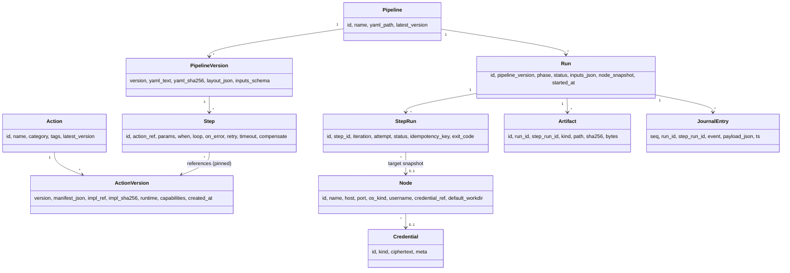
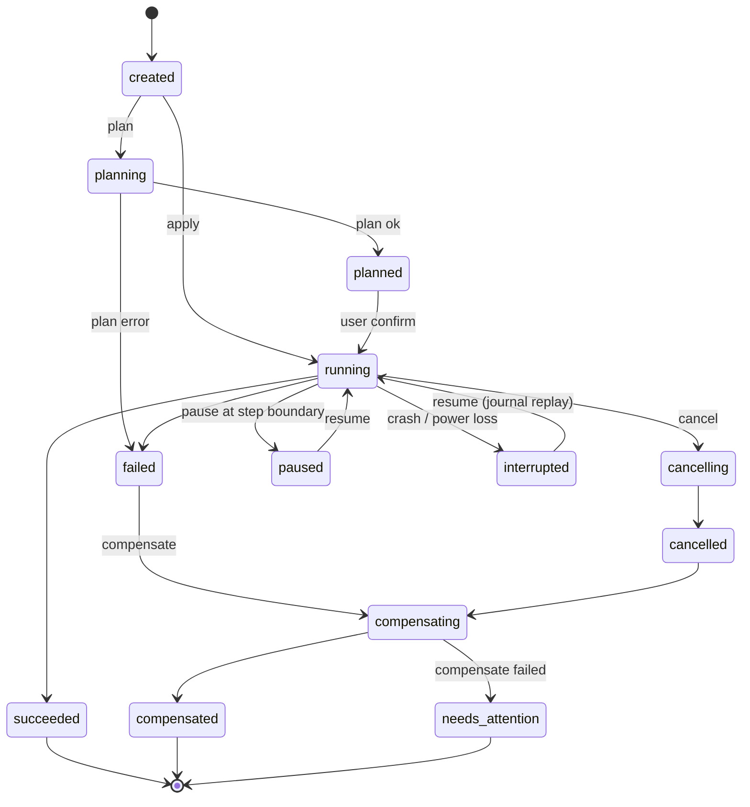
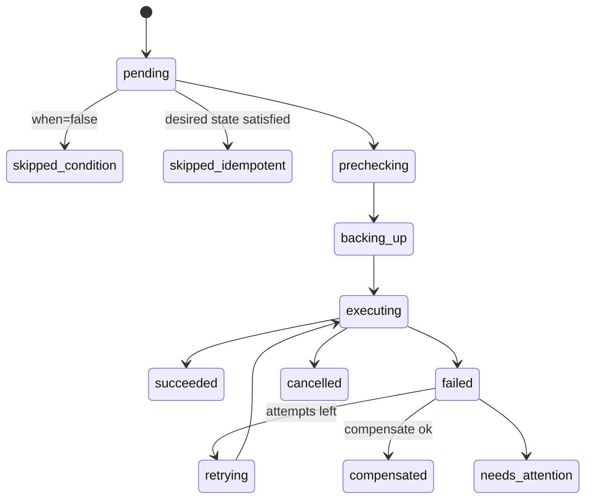

# WFP 需求规格说明书（Requirements Specification）

> **本文件是需求的唯一真源（single source of truth）。**
> 所有派生需求带 `DR-xx` 编号；代码注释、测试用例名、CI 门禁、评审记录都必须引用对应 DR ID。
> 引用规范见 §9.1。追溯矩阵（IR→DR→QC）由 `tools/gen_traceability.py` 从本文件自动生成，**不要手工维护副本**。

| 项 | 值 |
| --- | --- |
| 项目代号 | WFP（Workflow Pipeline Platform，通用流水线平台） |
| 文档版本 | v1.1（OQ-02 已决议；M0 编码进行中） |
| 日期 | 2026-11-15 |
| 状态 | **待客户签署**（见 §10 开放问题与 §11 签署栏） |
| 运行形态 | Python 后端 + 本地 Web UI，执行环境默认 **Windows 本机** |
| 使用规模 | **单机单用户**（无账号体系、无 RBAC、无集群调度） |
| 关联文档 | `architecture-design.md`（架构与 ADR）、`implementation-plan.md`（里程碑与 WBS）、`qualification-strategy.md`（合格性策略）、`traceability.csv` / `traceability.md`（自动生成的追溯矩阵） |

---

## 0. 本轮交付边界与过程说明

客户给定的"流程动作模型"被完整映射到本轮交付物，逐条落位如下：

| 过程动作（客户给定） | 本文落位 | 状态 |
| --- | --- | --- |
| Agreeing input requirements with customer | §2 输入需求 IR-01…IR-25（逐条回述 + 解释 + 待确认项） | 待客户签署（§10 OQ-01…OQ-08） |
| Analysis of input requirements to determine risks and potential pitfalls | §3 风险与陷阱分析 RA-01…RA-18 | 完成 |
| Creating one or more models to investigate possible strategies | §4 模型 MD-01…MD-08 + `architecture-design.md` §2 方案比选与 ADR | 完成 |
| Generating requirements derived from the input requirements | §5 派生需求 DR-01…DR-83（含验收准则） | 完成 |
| Generating a qualification strategy | §6 合格性策略概要 + `qualification-strategy.md` 全量 QC 用例 | 完成 |
| Agreeing the derived requirements with the implementing team(s) | `implementation-plan.md` §6 评审与签署、§2 WBS 责任人 | 待评审会（计划 D+3） |
| Establishing the satisfaction relationship (Input → Derived) | §7.1 满足关系矩阵（自动生成）+ `traceability.csv` 的 `sources_ir` 列 | 完成（机器校验） |
| Establishing the qualification relationship (Derived → Qualification) | §7.2 合格性关系矩阵（自动生成）+ `traceability.csv` 的 `qc_id/method/test_id/gate` 列 | 完成（机器校验） |

**本轮不做**：可运行代码实现（仅交付规格/架构/计划 + 规范性 Schema 与示例夹具）。M0 起进入编码。

---

## 1. 范围、术语与约束

### 1.1 目标（一句话）

把"复杂且繁琐、重复发生的运维/交付动作"沉淀为**可复用、可校验、可干跑、可回退**的基本动作，用**声明式工作项**组合它们，在本机一键执行，并留下可审计的证据。

### 1.2 范围内（In Scope）

- 本地 Web 管理平台（7 个页面，见 DR-40）+ CLI 等价入口。
- 基本动作库：manifest + 实现体，多 runtime（builtin / python / powershell / cmd / remote）。
- 工作项编排：串联、分支、循环、子工作项调用；图 ⇄ YAML 双视图。
- 执行引擎：plan（干跑，零副作用）/ apply（前置备份）/ compensate（补偿回退）。
- 远程节点与凭据管理、"当前目标节点"选择。
- 运行面板（步骤树 + 日志流 + 证据）、历史与报表、设置、审计。
- 全局安装（`pipx install wfp`）与离线分发。

### 1.3 范围外（Out of Scope，本轮明确不做）

| 编号 | 不做项 | 理由 | 未来位置 |
| --- | --- | --- | --- |
| OS-01 | 多用户 / 登录 / RBAC / 租户隔离 | 单机单用户（IR-23） | 若规模变化再启新项目 |
| OS-02 | 定时调度 / 事件触发 / Webhook / 常驻守护 | 本轮目标是"一键执行"，非"无人值守" | M6+ 候选（ADR-10） |
| OS-03 | 分布式执行器 / 队列 / 多机并发编排 | 单机单用户 | 不规划 |
| OS-04 | 完整 CI/CD 制品仓库、审批流引擎 | 与既有工具重叠 | 不规划 |
| OS-05 | 图形化"任意代码"低代码编程（表达式图灵完备） | 安全与可维护性（RA-17） | 用 script.* 动作逃生 |
| OS-06 | Linux/macOS 作为**主控端**的一等支持 | 主控默认 Windows（IR-22） | 代码保持可移植，CI 跑 Linux 单测；不作为验收平台 |

### 1.4 术语

| 术语 | 定义 |
| --- | --- |
| 基本动作 Action | 单元执行的动作。**契约（manifest）+ 实现体（impl）** 的一体化版本对象。 |
| 动作版本 ActionVersion | `action_id@version`，不可变。修改 = 新版本。 |
| 工作项 Pipeline | 用声明式 YAML 把多个动作按顺序/分支/循环组合的可执行单元。 |
| 步骤 Step | 工作项中的一次动作调用（含参数绑定、条件、循环、错误策略）。 |
| 运行 Run | 工作项的一次执行实例，含阶段（plan/apply/compensate）、输入快照、目标节点快照。 |
| 步骤运行 StepRun | 步骤的一次执行实例（循环/重试会产生多个）。 |
| 目标节点 Node | 远程被操作主机；"当前目标节点"是全局单选的运行上下文。 |
| 证据 Artifact | 执行留痕：diff、备份文件、校验报告、远端返回、原始日志。 |
|  journal | 只追加的执行日志（DB 表），用于崩溃恢复、幂等判定、补偿定位。 |
| 能力声明 Capability | 动作对自身 `dry_run / idempotent / compensate / needs_admin / needs_network` 的显式声明。 |
| workspace | 相对路径的解析基准目录（DR-24）。 |

### 1.5 约束（Constraints）

- C-01 主控端：Windows 10 21H2+/11 x64，Python 3.11+，PowerShell 5.1 或 7.x（DR-06 自诊断）。
- C-02 技术栈固定：前端 React + React Flow + Monaco + rjsf；后端 Python + SQLite（IR-19）。
- C-03 离线可用：UI 静态资源随包分发，运行期不依赖 CDN/外网（DR-07、DR-73）。
- C-04 存储：SQLite 单文件 + 文件系统 artifacts；不引入外部数据库/消息中间件。
- C-05 凭据不得明文落盘、不得进日志/证据/命令行（DR-52、DR-53）。
- C-06 单用户单并发 apply（DR-02、DR-39）。

### 1.6 假设（Assumptions，需客户确认）

- A-01 **[已确认 2026-11-15]** 远程目标以 **Linux over SSH 为主**。SSH 为 M2 Must（DR-54）；Windows/WinRM 降为可选增强，拆分为 **DR-84（Should，M5）**，不阻塞 M2 与 E2E-01/02。
- A-02 "查看窗口/编辑窗口"指**动作实现体的查看/编辑编辑器** + **运行输出的查看窗口**（→ OQ-03）。
- A-03 单机磁盘可用 ≥ 5 GB 用于 venv/artifacts；单工作项规模 ≤ 500 步、单动作输出 ≤ 100 MB。
- A-04 客户既有 Python 脚本可接受"入口函数/命令行入口"改造（解决 IR-14 缺少入口，DR-12/DR-15）。
- A-05 AI 辅助（IR-05）为**可选增强**，默认关闭，不作为主链路依赖（→ OQ-05）。

---

## 2. 输入需求（Input Requirements，IR）

> 逐条回述客户原始输入，附我方解释与影响。**IR 是"客户说了什么"，DR 是"系统必须做到什么"**。

| ID | 客户原始输入（摘要） | 我方解释 / 边界 | 主要派生 |
| --- | --- | --- | --- |
| IR-01 | 可视化管理平台：创建可复用基本动作 → 拖拽组合成自定义工作项（固定或带配置）→ 一键执行 | 三件事：动作库、编排器、执行器。"带配置"= 工作项 inputs 表单 | DR-01,13,20,27,28,41,42,44 |
| IR-02 | Windows 基本动作：解压缩、修改配置文件、上传、下载、校验、本地执行脚本、远程执行、删除 | 8 类必须内置且带契约；见 DR-19 动作清单 | DR-19,12,17 |
| IR-03 | 【本地执行脚本】查看窗口？编辑窗口？ | 解释为脚本实现体查看/编辑 + 运行输出查看（A-02/OQ-03） | DR-03,62 |
| IR-04 | 建立本地库；安装到全局，可以被使用 | 全局 CLI + 本地数据目录 + 本机 Web 服务；解决"缺少入口" | DR-04,05,09 |
| IR-05 | 设计评估：拖拽过于麻烦，可视化查看是优点；核心是逻辑本身，"描述逻辑 + AI 转换"更快 | **YAML 为真源、图为视图**；AI 作为可选草案生成器，双闸校验 | DR-45,44,80,81,82,83 |
| IR-06 | 基本动作 = 单元执行动作；是否每个动作都能抽象为一次脚本调用？ | 结论：**统一契约、不统一实现**。builtin 保留进程内实现以获得校验与真干跑（ADR-02） | DR-10,11,12 |
| IR-07 | 工作项 = 串联/组合/分支/循环 组合多个基本动作 | 顺序 + when 分支 + for_each/while 有界循环 + 子工作项调用 | DR-20,21,22 |
| IR-08 | 配置管理：添加远程节点（ip/用户名/密码/描述）；选择"当前目标节点" | 节点 CRUD + 全局单选上下文 + 运行时快照固化 | DR-50,51 |
| IR-09 | 动作管理：增删改；动作 = manifest + 实现体；编辑 python 脚本/命令/参数；持久化 SQLite | 版本化不可变 + 内容寻址实现体 + SQLite | DR-10,13,14,16 |
| IR-10 | 多 runtime 表：builtin / python / powershell / cmd / remote，各自隔离与取消手段 | 适配器统一接口 + 子进程进程树 kill + 通道超时 | DR-12,15,35,36,54 |
| IR-11 | 远程如何实现？用 Fabric？ | 结论：paramiko 为核心（SFTP+exec），fabric 仅作可选兼容层；Windows 目标用 pypsrp/WinRM（ADR-04） | DR-54,55,56,57,58,59 |
| IR-12 | 幂等/干跑/补偿三阶段：plan 零副作用、apply 前置备份、compensate 步骤级声明 | 三阶段成为一等 API 与 UI 流程；能力声明强制 | DR-17,30,31,32,33,34 |
| IR-13 | 工作项管理：增删改 + 能组合基本动作 | CRUD + 版本 + 导入导出 + lint | DR-28,29 |
| IR-14 | 脚本执行的麻烦点：缺少入口 | CLI（`wfp run/plan`）+ 动作 entry 契约 + 单动作试跑 | DR-09,12,41 |
| IR-15 | 重复例 1：移动压缩包→解压→检测配置存在（相对路径，异常报错退出）→改 json→连接当前节点→远程命令1→上传文件夹与2个文件→编辑远程 json→远程命令2→远程命令3 | **E2E 验收场景 E2E-01**（规范示例见 `examples/pipeline.deploy-sample.yaml`） | DR-19,24,26,51,55,56 |
| IR-16 | 重复例 2：连接当前目标节点 → 修改远程 yaml | **E2E-02** | DR-51,55 |
| IR-17 | 重复例 3：下载某个文件 | **E2E-03**（远端→本地） | DR-19,54 |
| IR-18 | 重复例 4：上传某个文件 | **E2E-04**（本地→远端） | DR-19,56 |
| IR-19 | 技术栈：React + React Flow + Monaco + rjsf；Python + SQLite | 固定（C-02） | DR-07,44,45,48,70 |
| IR-20 | 页面：动作库 / 工作项列表 / 编排（图⇄YAML双栏）/ 运行面板（步骤树+日志流+证据）/ 节点与凭据 / 历史与报表 / 设置 | 7 页 IA 固定 | DR-40,41,42,43,60,63,65,66,67,50 |
| IR-21 | 双视图同步（DR-45）：ruamel round-trip 保注释；图编辑产出最小 patch（仅改 step 字段）→ 应用到 YAML 文档树 → 回写；布局存 `pipeline.layout.json`，语义无关；round-trip 无损为 M3 门禁 | **客户已指定 DR-45 编号，本规格予以保留**；无损门禁 = DR-47 / G3 | DR-45,46,47 |
| IR-22 | 运行形态：Python + 本地 Web 平台；执行环境默认 Windows 本机 | 回环绑定 + 自动开浏览器 + Windows 进程语义 | DR-01,04,35,36,72 |
| IR-23 | 使用规模与凭据安全：单机单用户 | 无账号；本机 token + DPAPI 加密 + 审计 | DR-02,52,53,68,72 |
| IR-24 | 交付：需求规格 + 架构设计与实施计划；开发记录 md；`requirements-spec.md` 为需求源，DR ID 在代码注释/测试中引用 | 本轮交付物 + 引用规范 §9.1 | DR-74,75,76 |
| IR-25 | 流程动作模型（RE 过程：确认→风险→建模→派生→合格性→团队一致→满足关系→合格性关系） | §0 映射表 + §7 双矩阵 + 机器校验 | DR-74,75 |

**输入需求覆盖门禁 G-REQ-1**：每条 IR 必须至少被 1 条 DR 满足（`tools/gen_traceability.py --check` 校验，未覆盖即失败）。

---

## 3. 输入需求分析：风险与陷阱（Risk & Pitfall Analysis）

> 每条给出：陷阱 → 后果 → 对策（落到 DR）→ 残余风险。这是"为什么规格长成这样"的依据。

| ID | 陷阱 / 风险 | 后果 | 对策（DR） | 残余风险 |
| --- | --- | --- | --- | --- |
| RA-01 | 纯拖拽编排的交互成本高于写文本（客户已指出 IR-05） | 用户绕过 UI 手写脚本，平台失去价值 | YAML 真源 + 图为视图（DR-45）、模板库、AI 草案（DR-80） | 复杂分支的图形表达仍不如文本；接受 |
| RA-02 | "每个动作都抽象成脚本调用"的抽象泄漏 | 失去参数校验、真干跑、证据结构化 | 统一**契约**而非统一实现；builtin 进程内（DR-11,12；ADR-02） | builtin 覆盖面需持续投入 |
| RA-03 | plan"零副作用"对第三方脚本/远程命令不可保证 | 干跑反而改了生产 | 能力声明 `dry_run: plan\|none`；无 plan 入口者**绝不执行**，输出"不可预测"占位（DR-30,31） | 用户可能误信占位；UI 必须显著标注 |
| RA-04 | 幂等错觉：解压/上传/远程命令重复执行产生副作用 | 重跑污染目标机 | 期望态探测 + 内容指纹 + 幂等键入 journal（DR-32） | 远端命令幂等性由作者负责，契约强制声明 |
| RA-05 | 补偿不可逆（删除、服务重启、远端脚本） | 回退承诺失真 | `compensate: supported\|none\|manual`；不可补偿项在 plan 中红色标注 + apply 前勾选确认（DR-17,34,49） | 人工清单需用户执行 |
| RA-06 | Windows 子进程杀不干净、黑窗闪烁、交互式阻塞 | 取消后残留进程/僵尸；UI 卡死 | Job Object + psutil 进程树 kill；`CREATE_NO_WINDOW`；stdin 关闭；`-NonInteractive`（DR-35,36） | 极端情况远端残留 → needs_attention（DR-59） |
| RA-07 | 凭据明文进 DB/日志/命令行/导出包 | 凭据泄露（单机也可能被同机进程/备份带走） | DPAPI/keyring 加密；env/临时文件注入；全链路脱敏；导出默认不含凭据（DR-52,53,05） | 同机管理员权限攻击不在防护范围（明示） |
| RA-08 | 远端 OS 差异（Linux SSH vs Windows WinRM）、提权、编码/换行 | 上传后文件损坏、命令行为不一致 | transport 适配器 + 能力探测 + 原子替换 + hash 校验（DR-54,55,56,57,58） | 特殊 shell（csh/fish）不支持，明示 |
| RA-09 | YAML ⇄ 图 round-trip 丢注释/键序/引号/锚点 | 用户不敢用图编辑，双视图失信 | ruamel round-trip + 最小 patch + 属性测试门禁（DR-45,47） | 非 step 区域的图编辑不支持（设计约束） |
| RA-10 | SQLite 并发写 + 长事务阻塞 UI；日志洪流入库 | UI 卡顿、`database is locked` | WAL + 短事务 + 单写队列；日志走 NDJSON 文件而非 DB 行（DR-38,61,70,71） | 超大 run 需清理策略（DR-69） |
| RA-11 | "单机单用户"被误解为无需安全 | 浏览器 CSRF / DNS rebinding / 误开局域网 | 回环绑定 + 随机 token + Origin/Host 校验；`--lan` 需显式口令（DR-72） | 用户主动 `--lan` 的风险自担并审计 |
| RA-12 | 客户既有脚本依赖冲突 | 一个脚本装包污染全局/其他动作 | per-fingerprint venv + 依赖锁 + 离线 wheelhouse（DR-15） | 极端二进制依赖需人工准备 |
| RA-13 | 长任务日志洪流冲垮前端 | 浏览器 OOM、界面无响应 | 落盘不丢 + SSE 背压 + UI 节流合并 + 虚拟滚动（DR-61,62,70） | 丢弃的是 UI 展示密度，不是数据 |
| RA-14 | "相对路径"基准歧义（IR-15 明确提到相对路径） | 在错误目录解压/上传，误删 | workspace 根定义 + 路径越界防护 + plan 显示**绝对目标路径**（DR-24,31） | 用户显式允许越界时自担 |
| RA-15 | 缺少入口（IR-14） | 平台装了不用 | 全局 `wfp` CLI + 开始菜单快捷方式 + 可选托盘 + 深链（DR-04,09,40） | 习惯养成需培训（DR-76） |
| RA-16 | 取消/崩溃后半上传、临时文件、远端会话残留 | 目标机脏状态 | journal + 清理阶段 + resume + needs_attention 清单（DR-37,59,64） | 断电时远端原子性依赖 temp+rename（DR-55） |
| RA-17 | AI 生成的动作/参数幻觉 | 执行不存在的动作或危险参数 | 只允许库内已存在动作 + schema/lint 双闸 + 强制 plan + 人工确认 + draft 不可 apply（DR-80,81,82） | 语义正确性仍靠人；AI 默认关闭（DR-83） |
| RA-18 | 范围膨胀（调度/多用户/集群/审批流） | 里程碑失守 | §1.3 不做清单 + 变更控制 §9.2 | 客户新增需求需走 CR |

---

## 4. 模型（用于比选策略与派生需求）

> 图形用 Mermaid 描述（在支持 Mermaid 的查看器中渲染；纯文本亦可读）。模型编号 MD-xx，DR 可引用模型作为派生依据。

### MD-01 领域模型（概念实体与关系）



**关键不变式（INV）**

- INV-01 `ActionVersion` 与 `PipelineVersion` **不可变**；编辑产生新版本（支撑可复现重跑，DR-16/28/65）。
- INV-02 `Run` 固化 `pipeline_version + inputs + node_snapshot + action_versions`；执行期间外部编辑不影响本次运行（DR-51）。
- INV-03 每个有副作用的 `StepRun` 在 apply 前必须有 `backup` 或显式 `no_backup_reason`（DR-33）。
- INV-04 `journal.seq` 单调递增且只追加；补偿与恢复只读 journal，不猜状态（DR-34/37）。
- INV-05 `Credential.ciphertext` 永不出库到 API 响应/日志/导出（DR-52/53）。

### MD-02 动作契约模型（manifest ⇄ 能力矩阵）

```
Action = Manifest（契约，可校验） + Impl（实现体，可执行）
Manifest = identity + runtime + entry + params(JSON Schema) + outputs + capabilities + policy + evidence + ui
```

| 能力字段 | 取值 | 引擎行为 |
| --- | --- | --- |
| `dry_run` | `plan` / `none` | `plan` → 调 `plan()` 产出 diff；`none` → **不执行**，PlanReport 标 `unpredictable` |
| `idempotent` | `yes` / `conditional` / `no` | `yes/conditional` → apply 前期望态探测，可 `skipped_idempotent`；`no` → resume 时需人工确认 |
| `compensate` | `supported` / `manual` / `none` | `supported` → 逆序自动回退；`manual` → 输出人工清单；`none` → plan 红标 + apply 勾选确认 |
| `needs_admin` | bool | plan 标记；apply 前检查令牌/会话权限 |
| `needs_network` | bool | 离线模式直接拒绝 |
| `side_effects` | `none` / `local_fs` / `remote_fs` / `remote_exec` / `destructive` | 决定备份策略与风险等级 |

**策略比选（回答 IR-06）**：见 `architecture-design.md` ADR-02。结论：**统一契约，不统一实现**；`builtin` 进程内实现是为了拿到"真干跑 + 结构化 diff + 零进程开销"，这三点单靠脚本调用无法保证。

### MD-03 执行状态机（Run / StepRun）





### MD-04 三阶段语义模型（幂等 / 干跑 / 补偿）

| 阶段 | 语义 | 允许的副作用 | 必须产出 | 失败处理 |
| --- | --- | --- | --- | --- |
| **plan** | 解析参数与路径、算 diff、列出将执行的动作与目标 | **零**（只读：stat/hash/read/远端只读命令） | `PlanReport`（步骤、绝对目标、diff、风险、不可补偿项、需管理员/网络） | 直接失败，不进入 apply |
| **apply** | 真正执行；每个副作用步骤**前置备份** | 有（受契约约束） | journal + artifacts + outputs | 按 `on_error`：fail / continue / compensate |
| **compensate** | 用备份或逆操作回退已成功步骤（**逆序**） | 有（受控） | 补偿报告 + 人工清单 | 停在 `needs_attention`，保留全部证据 |

**幂等判定式**：`idempotency_key = sha256(action_ref + resolved_params + target_identity + desired_state_fingerprint)`；journal 中存在同 key 的成功记录且探测仍满足 → `skipped_idempotent`（DR-32）。

### MD-05 编排语义模型

```
pipeline := meta + inputs(JSON Schema) + vars + defaults + steps[]
step     := id + uses(action@version) + with(params) + when? + loop? + retry? + timeout? + on_error? + compensate? + register?
loop     := for_each(items) | while(cond, max_iterations) ; scope: item / index
branch   := when(expr) -> then step | else 分支由后续 step 的 when 表达（显式、无隐藏图语义）
call     := uses: pipeline:<id>@<ver> with: {...}   # 深度 ≤ 5，禁止环
```

**图 ⇄ 语义映射约束**：图上的"分支/循环"是**容器节点**，一一对应 YAML 的 `when/loop` 字段；图上不允许表达 YAML 无法表达的语义（保证 DR-45 最小 patch 可行）。

### MD-06 双视图同步模型（DR-45 的概念基础）

```
        ┌────────────── 真源 ──────────────┐
YAML text ──ruamel.round-trip──> YAML doc tree ──project──> GraphModel(steps, containers, edges)
   ▲                                   ▲                          │
   │                                   │                          │ user edit
   │                            minimal patch                GraphDelta
   │                          (仅 step 字段)                      │
   └────────── dump(保注释/键序/引号) ◀── apply patch ◀── translate ┘

layout（坐标/折叠/分组/视口）── 独立文件 pipeline.layout.json ── 语义无关，永不进 YAML
```

三条铁律：
1. **单向真源**：YAML 文本是唯一真源；图是投影。任何图编辑最终表达为对 doc tree 的最小 patch。
2. **最小 patch**：只允许 `add/remove/replace` 到 `steps[i]` 及其字段路径；禁止整树重排/整段 dump 覆盖。
3. **布局分离**：语义无关信息不进 YAML（DR-46），删除 layout 不影响执行结果。

### MD-07 远程会话模型（transport 能力矩阵）

| 能力 | ssh-linux (paramiko) | ssh-windows (paramiko+PS) | winrm (pypsrp) |
| --- | --- | --- | --- |
| exec + exit code | ✅ | ✅ | ✅ |
| put/get 文件 | ✅ SFTP | ✅ SFTP | ✅（分块 base64/PSRP） |
| 递归目录上传 | ✅ | ✅ | ✅（打包传输） |
| 远端 hash | `sha256sum` | `Get-FileHash` | `Get-FileHash` |
| 原子替换 | `mv` temp | `Move-Item -Force` | `Move-Item -Force` |
| 提权 | `sudo -n` / 凭据注入 | 管理员会话 | 管理员会话 |
| 取消远端进程 | 通道关闭 + `kill -TERM` | `taskkill /T` | `Stop-Process` / pipeline stop |
| 编码/换行 | UTF-8 / LF | UTF-8 / CRLF 保留 | UTF-8 / CRLF 保留 |

### MD-08 进程与部署模型（单机）

```
浏览器 (React SPA, 静态资源由后端提供)
   │ HTTP/REST + SSE(日志/事件)  仅回环 127.0.0.1:8765 + 本机 token
   ▼
wfp serve  ── FastAPI/Uvicorn（API 进程，短事务）
   │  ├─ SQLite(WAL)  元数据/审计/journal
   │  └─ 文件系统      artifacts / logs(NDJSON) / venvs / keys
   │ spawn（子进程，可 kill 进程树）
   ▼
wfp-runner（执行进程，每个 Run 一个）
   ├─ builtin 动作：进程内调用（只读 plan / 有副作用 apply）
   ├─ python 动作：venv 子进程（进程树管控）
   ├─ powershell/cmd：子进程 -NonInteractive / CREATE_NO_WINDOW
   └─ remote 动作：SSH/WinRM 会话 → 目标节点
```

**为什么 runner 独立进程**：取消要能杀干净（RA-06）、崩溃不带走 API（DR-71）、依赖隔离（RA-12）。详见 ADR-03。

---

## 5. 派生需求（Derived Requirements，DR）

**读法**：每条 DR = 一句可验证的"系统应…"（陈述）+ 来源（满足关系）+ 优先级/里程碑 + 验收准则 + 合格性用例（合格性关系）。
**优先级**：Must（MVP 必须）/ Should（重要可延后）/ Could（可选增强）。
**里程碑**：M0…M5，定义见 `implementation-plan.md`。**门禁**：G0…G5，见 `qualification-strategy.md`。
**编号约定**：DR-45 依客户指定保留给"双视图最小 patch 同步"（IR-21）。编号一经发布不复用、不回收。

### 5.1 平台形态、安装与入口（DR-01…DR-09）

#### DR-01 本地 Web 平台形态
- 陈述：系统应以本机 Python 服务进程提供 Web UI 与 REST API，默认仅绑定 `127.0.0.1:8765`（端口可配置），启动后可自动打开默认浏览器。
- 来源：IR-01, IR-22｜MD-08｜RA-11
- 优先级：Must｜里程碑：M0
- 验收：全新环境执行 `wfp serve` 后，`http://127.0.0.1:8765` 返回 200 且加载 7 页导航；`netstat` 显示监听地址为 127.0.0.1；端口被占用时给出明确错误与 `--port` 提示。
- 合格性：QC-01｜T·集成｜门禁 G0｜tests/integration/test_dr01_local_web.py

#### DR-02 单机单用户模型
- 陈述：系统应无账号体系，使用启动时生成的本机会话 token 鉴权；同一时刻最多 1 个 apply 运行、最多 2 个 plan 运行，超限请求排队并显示占用者。
- 来源：IR-23｜MD-08｜RA-11
- 优先级：Must｜里程碑：M0
- 验收：无 token 的 API 请求返回 401；并发提交 2 个 apply 时第二个进入 `queued` 且 UI 显示占用 run id；plan 可与 apply 并行且不产生写冲突。
- 合格性：QC-02｜T·集成｜门禁 G0｜tests/integration/test_dr02_single_user_lock.py

#### DR-03 实现体查看/编辑窗口
- 陈述：动作详情页应提供实现体的**查看窗口**（只读、语法高亮、与上一版本 diff）与**编辑窗口**（Monaco，支持 Python/PowerShell/CMD/YAML/JSON，保存即生成新动作版本）。
- 来源：IR-03, IR-09｜A-02
- 优先级：Must｜里程碑：M0
- 验收：编辑 Python 实现体保存后生成 `v+1` 且旧版本仍可被既有工作项引用；查看窗口能显示与前一版本的行级 diff；未保存离开有脏数据提示。
- 合格性：QC-03｜T·E2E｜门禁 G0｜tests/e2e/test_dr03_impl_editor.py

#### DR-04 全局安装与统一入口
- 陈述：系统应支持 `pipx install wfp`（或 `pip install wfp`）全局安装，提供 `wfp` 命令族：`serve/run/plan/action/pipeline/node/doctor/export/import`；Windows 安装后可创建开始菜单快捷方式与可选托盘图标。
- 来源：IR-04, IR-14｜RA-15
- 优先级：Must｜里程碑：M0（`serve/doctor`）/ M5（打包与快捷方式完整化）
- 验收：在任意目录执行 `wfp --help` 列出全部子命令；`wfp doctor` 可运行；`wfp run <pipeline>` 无需打开浏览器即可完成执行。
- 合格性：QC-04｜T·E2E｜门禁 G5｜tests/e2e/test_dr04_global_install.py

#### DR-05 数据目录与可迁移性
- 陈述：所有可变状态应位于单一数据目录（默认 `%LOCALAPPDATA%\WFP`，可由 `WFP_HOME` 覆盖），含 `wfp.db / artifacts / logs / venvs / keys`；提供 `wfp export/import` 打包迁移，**默认不含凭据密文**。
- 来源：IR-04, IR-23｜RA-07
- 优先级：Must｜里程碑：M0
- 验收：设置 `WFP_HOME` 后所有写入落在该目录；export 生成的 zip 在另一台机器 import 后动作/工作项/历史可用，凭据需重新录入且提示明确。
- 合格性：QC-05｜T·集成｜门禁 G0｜tests/integration/test_dr05_data_home_export.py

#### DR-06 环境自诊断
- 陈述：`wfp doctor` 应检查 Python 版本、PowerShell 可用性与版本、数据目录可写性、磁盘余量、端口占用、DPAPI/keyring 可用性、SSH 客户端能力，输出结构化结果与修复建议。
- 来源：IR-04, IR-22｜C-01
- 优先级：Should｜里程碑：M0
- 验收：人为制造 3 种故障（端口占用、目录只读、无 PowerShell）时 doctor 均给出对应错误码与建议；退出码非 0。
- 合格性：QC-06｜T·集成｜门禁 G0｜tests/integration/test_dr06_doctor.py

#### DR-07 前端离线分发
- 陈述：前端构建产物应随后端包分发并由后端静态托管，运行期不得请求任何外部 CDN/字体/脚本；本地首屏可交互时间 < 2s（冷启动 < 5s）。
- 来源：IR-19, IR-22｜C-03
- 优先级：Must｜里程碑：M0
- 验收：断网环境下 UI 全功能可用；浏览器 Network 面板无第三方域请求；性能断言在基准机（8C16G SSD）达标。
- 合格性：QC-07｜T·E2E｜门禁 G0｜tests/e2e/test_dr07_offline_ui.py

#### DR-08 数据库版本与迁移
- 陈述：SQLite 应记录 schema 版本并在启动时执行前向迁移；迁移前自动备份 DB 文件（保留最近 5 份），迁移失败必须回滚并拒绝启动。
- 来源：IR-09｜RA-10｜INV-01
- 优先级：Must｜里程碑：M0
- 验收：从 v1 库升级到 v2 后数据完整；注入迁移异常时 DB 保持原样、进程退出码非 0 且提示备份路径。
- 合格性：QC-08｜T·集成｜门禁 G0｜tests/integration/test_dr08_migrations.py

#### DR-09 CLI 与 UI 能力等价
- 陈述：工作项的 plan/apply/compensate/resume、动作与节点的 CRUD 应均可通过 CLI 完成；CLI 退出码约定：0 成功、2 参数/校验错、3 执行失败、4 已取消、5 需人工介入。
- 来源：IR-04, IR-14｜RA-15
- 优先级：Must｜里程碑：M1
- 验收：同一工作项分别经 UI 与 CLI 执行，journal 事件序列语义一致；5 类退出码各有用例覆盖。
- 合格性：QC-09｜T·E2E｜门禁 G1｜tests/e2e/test_dr09_cli_parity.py

### 5.2 动作库与契约（DR-10…DR-19）

#### DR-10 动作 = manifest + 实现体（版本化持久化）
- 陈述：每个动作应持久化为 `Action` + 不可变 `ActionVersion`（manifest JSON + 实现体内容寻址存储 + sha256），全部落 SQLite/数据目录。
- 来源：IR-09, IR-06｜MD-01｜INV-01
- 优先级：Must｜里程碑：M0
- 验收：创建动作后 DB 中 manifest 与 impl 哈希一致；修改实现体产生新版本且旧版本字节不变；删除动作为软删除且被引用时拒绝硬删。
- 合格性：QC-10｜T·集成｜门禁 G0｜tests/integration/test_dr10_action_versions.py

#### DR-11 manifest 规范（JSON Schema 2020-12）
- 陈述：manifest 应符合 `schemas/action-manifest.schema.json`，至少包含 `id/name/version/runtime/entry/params/outputs/capabilities/policy(timeout,retry)/evidence/ui`；入库前必须通过 schema 校验。
- 来源：IR-09, IR-06, IR-10｜MD-02
- 优先级：Must｜里程碑：M0
- 验收：缺失必填字段、非法 runtime、params 非合法 JSON Schema 时拒绝入库并返回字段级错误路径（如 `capabilities.dry_run`）。
- 合格性：QC-11｜T·单元｜门禁 G0｜tests/unit/test_dr11_manifest_schema.py

#### DR-12 runtime 适配器统一接口
- 陈述：引擎应通过统一接口 `prepare/plan/apply/compensate/cancel` 驱动 5 类 runtime：`builtin`（进程内）、`python`（venv 子进程）、`powershell`、`cmd`、`remote`（SSH/WinRM）；每类必须实现取消与超时。
- 来源：IR-10, IR-06, IR-11｜MD-02, MD-08｜ADR-02
- 优先级：Must｜里程碑：M1（builtin/python/cmd/powershell）/ M2（remote）
- 验收：5 类 runtime 各有一个"回显参数"动作通过同一契约测试套件；每类在超时后 10s 内进程/会话被回收。
- 合格性：QC-12｜T·集成｜门禁 G2｜tests/integration/test_dr12_runtime_adapters.py

#### DR-13 动作库 CRUD 与组织
- 陈述：应支持动作的新增/编辑（新版本）/软删除/复制为新动作/启停，支持分类、标签、全文搜索与"被哪些工作项引用"反查。
- 来源：IR-09, IR-01｜MD-01
- 优先级：Must｜里程碑：M0
- 验收：被引用的动作删除时返回引用清单并拒绝；搜索命中名称/标签/描述；复制动作不共享实现体哈希以外的可变状态。
- 合格性：QC-13｜T·集成｜门禁 G0｜tests/integration/test_dr13_action_crud.py

#### DR-14 参数契约校验（入库 + 运行前）
- 陈述：系统应在入库时校验 manifest 自身，在 plan/apply 前用 `params` JSON Schema 校验每个 step 的实参，错误须定位到 `steps[i].with.<field>` 并给出期望类型/枚举/范围。
- 来源：IR-09, IR-01｜MD-02｜RA-02
- 优先级：Must｜里程碑：M1
- 验收：类型错、必填缺失、枚举越界、正则不匹配 4 类错误均被拦截且路径精确；错误信息可直接在 Monaco/rjsf 中定位高亮。
- 合格性：QC-14｜T·单元｜门禁 G1｜tests/unit/test_dr14_param_validation.py

#### DR-15 Python 依赖隔离
- 陈述：`python` runtime 应按 requirements 指纹创建/复用独立 venv，依赖安装支持本地 wheelhouse 离线安装，并记录锁指纹；不同动作的依赖冲突不得互相影响。
- 来源：IR-10｜RA-12｜ADR-02
- 优先级：Must｜里程碑：M1
- 验收：两个动作分别要求同一库的不兼容版本，均可正常执行；断网时用 wheelhouse 安装成功；venv 复用命中率与创建耗时被记录。
- 合格性：QC-15｜T·集成｜门禁 G1｜tests/integration/test_dr15_venv_isolation.py

#### DR-16 动作版本引用与固定
- 陈述：step 必须以 `action_id@version` 精确引用动作版本（允许 `@^1` 但保存时解析并固定为精确版本）；升级引用需显式操作并展示 diff。
- 来源：IR-09｜INV-01, INV-02
- 优先级：Must｜里程碑：M1
- 验收：动作发布新版本后既有工作项行为不变；执行"升级引用"后 YAML 中版本号被最小 patch 更新且注释保留（联动 DR-45）。
- 合格性：QC-16｜T·集成｜门禁 G1｜tests/integration/test_dr16_version_pinning.py

#### DR-17 能力声明强制
- 陈述：manifest 必须显式声明 `dry_run(plan|none)`、`idempotent(yes|conditional|no)`、`compensate(supported|manual|none)`、`needs_admin`、`needs_network`、`side_effects`；缺声明拒绝入库，UI 以徽章展示。
- 来源：IR-12, IR-10｜MD-02｜RA-03, RA-04, RA-05
- 优先级：Must｜里程碑：M0
- 验收：缺任一能力字段的 manifest 入库失败；动作库列表正确显示三类徽章；`dry_run: none` 的动作在 plan 中被标 `unpredictable`。
- 合格性：QC-17｜T·单元｜门禁 G0｜tests/unit/test_dr17_capabilities_required.py

#### DR-18 动作契约一致性测试套件
- 陈述：平台应提供可复用的契约测试套件，任何动作（含用户自建）在发布前必须通过 8 项检查：schema 合法、plan 零副作用探针、参数校验、取消响应、超时响应、outputs 结构、敏感值脱敏、证据产出。
- 来源：IR-06, IR-12, IR-10｜RA-02, RA-03｜DR-75
- 优先级：Must｜里程碑：M1
- 验收：故意构造 8 种违约动作，套件逐一失败并给出违约项；内置动作全部通过；套件可由 `wfp action test <id>` 触发。
- 合格性：QC-18｜T·集成｜门禁 G1｜tests/integration/test_dr18_contract_suite.py

#### DR-19 内置动作集（覆盖 IR-02 八类）
- 陈述：应内置以下动作并全部具备 plan 能力：`archive.extract/pack`、`fs.copy/move/delete`、`config.edit`（json/yaml/ini）、`net.upload/net.download`、`assert.file_exists/checksum/json_schema`、`script.local`（python/powershell/cmd）、`remote.exec/upload/download/config_edit`。
- 来源：IR-02, IR-15, IR-16, IR-17, IR-18｜MD-02
- 优先级：Must｜里程碑：M1（本地类）/ M2（remote 类）
- 验收：8 类各有 ≥1 个 plan+apply 用例；`assert.file_exists` 失败时按 IR-15 要求"报错退出"（默认 on_error=fail）；`config.edit` 产出行级 diff 证据。
- 合格性：QC-19｜T·集成｜门禁 G2｜tests/integration/test_dr19_builtin_actions.py

### 5.3 工作项与编排语义（DR-20…DR-29）

#### DR-20 工作项声明式 Schema
- 陈述：工作项应以 YAML 定义，顶层含 `apiVersion/meta/inputs/vars/defaults/steps`；`steps` 为有序列表，每步含 `id/uses/with` 及可选 `when/loop/retry/timeout/on_error/compensate/register`；schema 由 `schemas/pipeline.schema.json` 约束。
- 来源：IR-07, IR-13, IR-01｜MD-05
- 优先级：Must｜里程碑：M1
- 验收：示例 `examples/pipeline.deploy-sample.yaml` 通过 schema 校验；未知顶层键、重复 step id、缺失 uses 均被拒绝并给出路径。
- 合格性：QC-20｜T·单元｜门禁 G1｜tests/unit/test_dr20_pipeline_schema.py

#### DR-21 分支与有界循环
- 陈述：应支持 `when: <表达式>` 条件跳过，`loop.for_each: <列表/通配>` 与 `loop.while: <条件>`（必须带 `max_iterations`，默认上限 1000）；循环体提供 `item/index` 作用域，超限即失败。
- 来源：IR-07｜MD-05｜RA-18
- 优先级：Must｜里程碑：M1
- 验收：for_each 3 元素产生 3 个 StepRun 且 index 正确；while 达到 max_iterations 时 run 失败并给出明确错误码；when=false 记 `skipped_condition`。
- 合格性：QC-21｜T·集成｜门禁 G1｜tests/integration/test_dr21_branch_loop.py

#### DR-22 子工作项调用
- 陈述：step 可通过 `uses: pipeline:<id>@<version>` 调用子工作项并映射 inputs；调用深度 ≤ 5，加载期检测循环引用并拒绝。
- 来源：IR-07, IR-13｜MD-05
- 优先级：Should｜里程碑：M4
- 验收：两级嵌套调用成功且步骤树可展开；构造 A→B→A 时报 `WFP-L012 循环引用`；深度 6 时报错。
- 合格性：QC-22｜T·集成｜门禁 G4｜tests/integration/test_dr22_subpipeline.py

#### DR-23 变量作用域与模板求值
- 陈述：变量优先级应为 `step.outputs > inputs > node > vars > env(白名单)`；模板用 Jinja2 SandboxedEnvironment，仅在 manifest 声明 `templatable` 的字段生效；凭据只能经 `secret('<id>')` 引用且求值结果不进入日志。
- 来源：IR-01, IR-08, IR-23｜MD-05｜RA-07
- 优先级：Must｜里程碑：M1
- 验收：同名变量按优先级解析；模板中访问 `os`/文件/网络被拒绝；`secret()` 的值在日志/证据/PlanReport 中一律显示 `***`。
- 合格性：QC-23｜T·单元｜门禁 G1｜tests/unit/test_dr23_scope_template.py

#### DR-24 路径语义与越界防护
- 陈述：相对路径必须基于 workspace 根（默认工作项 YAML 所在目录，可由 `meta.workdir` 或运行输入覆盖）；远端路径必须显式 `remote:` 前缀或 `node` 上下文；默认禁止解析到 workspace 之外，越界需 `allow_outside_workspace: true` 显式开启。
- 来源：IR-15, IR-16｜RA-14
- 优先级：Must｜里程碑：M1
- 验收：`../` 越界默认报错 `WFP-L020`；plan 报告中所有目标显示为绝对路径（本地）或 `node:/abs/path`（远端）；同一 YAML 在不同 CWD 下执行结果一致。
- 合格性：QC-24｜T·集成｜门禁 G1｜tests/integration/test_dr24_path_resolution.py

#### DR-25 表达式安全求值
- 陈述：`when/while/vars` 表达式不得使用 `eval` 执行任意 Python；应使用受限求值器（白名单运算与函数：比较/逻辑/算术/`len/contains/startswith/endswith/regex_match/json_get/default`），单次求值超时 50ms。
- 来源：IR-07｜RA-17, OS-05
- 优先级：Must｜里程碑：M1
- 验收：`__import__('os').system(...)`、属性穿越、推导式滥用被拒绝；恶意长表达式在 50ms 内超时失败而非挂起。
- 合格性：QC-25｜T·单元｜门禁 G1｜tests/unit/test_dr25_safe_expr.py

#### DR-26 步骤级错误策略与重试
- 陈述：每步可声明 `timeout`（默认 300s）、`retry{attempts,backoff,delay}`（默认 0 次）、`on_error: fail|continue|compensate`（默认 fail）；重试须产生独立 attempt 记录。
- 来源：IR-15, IR-07｜MD-03
- 优先级：Must｜里程碑：M1
- 验收：flaky 动作前 2 次失败第 3 次成功时 run 成功且 attempt=3；`on_error: continue` 时后续步骤仍执行且 run 标 `succeeded_with_warnings`；默认 fail 时立即终止（IR-15 语义）。
- 合格性：QC-26｜T·集成｜门禁 G1｜tests/integration/test_dr26_retry_on_error.py

#### DR-27 工作项输入表单
- 陈述：工作项 `inputs` 应为 JSON Schema，运行前由 rjsf 渲染表单（必填/默认/枚举/条件字段/路径选择器/节点选择器）；CLI 用 `--input k=v` 或 `--inputs-file`，两端校验一致。
- 来源：IR-01, IR-13｜MD-05
- 优先级：Must｜里程碑：M1（CLI+校验）/ M3（rjsf 表单）
- 验收：缺必填输入时 UI 与 CLI 均拒绝执行且错误字段一致；输入快照写入 Run 记录可用于复现。
- 合格性：QC-27｜T·集成｜门禁 G3｜tests/integration/test_dr27_inputs_form.py

#### DR-28 工作项 CRUD 与导入导出
- 陈述：应支持工作项新增/编辑（新版本）/删除/复制/导入导出；导出包含 YAML + layout + 依赖动作清单（可选携带动作实现体），导入时校验依赖并提示缺失。
- 来源：IR-13, IR-01｜INV-01
- 优先级：Must｜里程碑：M1
- 验收：导出 zip 在干净实例导入后可直接 plan；缺失动作时列出 `action@version` 清单并阻止 apply；删除工作项不影响历史 run 记录。
- 合格性：QC-28｜T·集成｜门禁 G1｜tests/integration/test_dr28_pipeline_crud.py

#### DR-29 静态校验（lint）
- 陈述：保存与执行前应执行 lint：未知动作/版本、参数不合 schema、未定义变量、不可达步骤、无界循环、循环引用、越界路径、不可补偿链、缺失 inputs；错误码 `WFP-Lxxx`，区分 error/warning。
- 来源：IR-13, IR-12｜RA-05, RA-14
- 优先级：Must｜里程碑：M1
- 验收：≥12 条 lint 规则各有正反用例；error 阻止 apply、warning 需确认；结果可在编排页问题面板点击跳转到 YAML 行。
- 合格性：QC-29｜T·单元｜门禁 G1｜tests/unit/test_dr29_lint_rules.py

### 5.4 执行引擎：干跑 / 幂等 / 补偿 / 隔离（DR-30…DR-39）

#### DR-30 三阶段执行 API
- 陈述：引擎应提供 `plan / apply / compensate` 三个阶段入口；plan 阶段只允许只读操作（stat/read/hash/远端只读命令），对 `dry_run: none` 的动作**不得执行任何实现体**，仅输出 `unpredictable` 占位。
- 来源：IR-12｜MD-04｜RA-03
- 优先级：Must｜里程碑：M1
- 验收：以文件系统快照 + 远端只读审计为证，plan 前后本地与远端状态字节级一致；`dry_run: none` 动作在 plan 期间进程数为 0。
- 合格性：QC-30｜T·集成｜门禁 G1｜tests/integration/test_dr30_plan_zero_side_effect.py

#### DR-31 PlanReport 与 diff 预览
- 陈述：plan 应产出结构化 `PlanReport`：步骤清单、绝对目标路径、配置行级 diff、风险等级、`needs_admin/needs_network` 标记、不可补偿项、`unpredictable` 项、预计备份清单。
- 来源：IR-12, IR-01｜MD-04｜RA-03, RA-14
- 优先级：Must｜里程碑：M1
- 验收：IR-15 场景的 plan 报告含 10 个步骤目标与 2 处配置 diff；不可补偿步骤被标红；报告可导出 JSON/Markdown。
- 合格性：QC-31｜T·集成｜门禁 G1｜tests/integration/test_dr31_plan_report.py

#### DR-32 幂等判定与跳过
- 陈述：对 `idempotent: yes|conditional` 的动作，apply 前应做期望态探测（存在性/哈希/键值/远端 hash），已满足则记 `skipped_idempotent`；幂等键 `sha256(action_ref+resolved_params+target+desired_state)` 写入 journal。
- 来源：IR-12｜MD-04｜RA-04
- 优先级：Must｜里程碑：M4
- 验收：同一工作项连续 apply 两次，第二次 `config.edit/fs.copy/archive.extract/net.upload` 全部跳过且零写操作；篡改目标文件后第三次 apply 仅修复被篡改项。
- 合格性：QC-32｜T·集成｜门禁 G4｜tests/integration/test_dr32_idempotency.py

#### DR-33 apply 前置备份
- 陈述：任何 `side_effects != none` 的步骤在 apply 前必须备份被改写/删除的对象到 artifacts（远端文件拉回本地），备份清单入 journal；无法备份的动作必须声明 `no_backup_reason` 并在 plan 中明示。
- 来源：IR-12｜MD-04, INV-03｜RA-05
- 优先级：Must｜里程碑：M1
- 验收：修改本地/远端 json 前生成备份且 sha256 校验通过；删除目录前生成压缩包备份；无备份能力的动作在 PlanReport 中出现 `no_backup_reason`。
- 合格性：QC-33｜T·集成｜门禁 G1｜tests/integration/test_dr33_pre_backup.py

#### DR-34 补偿（逆序回退）
- 陈述：compensate 应按已成功步骤的**逆序**执行其 `compensate` 实现或备份还原；`compensate: manual` 输出人工清单，`none` 跳过并标注；补偿自身失败时 run 进入 `needs_attention` 并保留全部证据。
- 来源：IR-12｜MD-03, MD-04｜RA-05
- 优先级：Must｜里程碑：M4
- 验收：IR-15 场景在第 8 步注入失败后补偿，本地/远端配置与文件恢复到 apply 前哈希；不可逆步骤出现在人工清单；补偿失败用例停在 needs_attention。
- 合格性：QC-34｜T·E2E｜门禁 G4｜tests/e2e/test_dr34_compensate.py

#### DR-35 进程隔离与进程树取消
- 陈述：非 builtin 动作应在子进程执行；取消/超时时 Windows 使用 Job Object（KILL_ON_JOB_CLOSE）+ psutil 递归兜底，POSIX 使用 setsid+killpg；取消后 3s 内发温和终止、10s 内强杀，进程树无残留。
- 来源：IR-10, IR-22｜MD-08｜RA-06
- 优先级：Must｜里程碑：M1
- 验收：构造"父进程 spawn 孙进程并 sleep"的动作，取消后 10s 内父子孙进程全部消失（Windows 与 Linux CI 各验一次）；超时同样生效。
- 合格性：QC-35｜T·集成｜门禁 G1｜tests/integration/test_dr35_process_tree_kill.py

#### DR-36 无窗口执行与可选可见控制台
- 陈述：默认以无窗口方式执行（Windows `CREATE_NO_WINDOW`，PowerShell `-NonInteractive -NoProfile`），stdin 关闭以防交互阻塞；动作可声明 `console: visible` 用于本机调试，但 apply 阶段仍禁止交互输入。
- 来源：IR-10, IR-22, IR-03｜RA-06
- 优先级：Must｜里程碑：M1
- 验收：执行 PowerShell 动作时无黑窗弹出；试图读 stdin 的动作立即得到 EOF 而非挂起；`console: visible` 时可见窗口且输出仍被采集。
- 合格性：QC-36｜T·集成｜门禁 G1｜tests/integration/test_dr36_console_mode.py

#### DR-37 崩溃恢复与续跑
- 陈述：Run 状态与 journal 应支持崩溃/断电后恢复：重启后未完成 run 标 `interrupted`，`wfp run resume <id>` 从最后未完成步骤续跑；幂等步骤可自动重放，非幂等步骤需用户确认。
- 来源：IR-12｜MD-03, INV-04｜RA-16
- 优先级：Should｜里程碑：M4
- 验收：在第 5 步 kill -9 runner 后重启，run 显示 interrupted 且前 4 步结果保留；resume 后不重复执行已成功的幂等步骤；非幂等步骤弹出确认。
- 合格性：QC-37｜T·E2E｜门禁 G4｜tests/e2e/test_dr37_crash_resume.py

#### DR-38 结构化事件与证据留存
- 陈述：执行应产出带版本号的 NDJSON 事件流（run/step 生命周期、stdout/stderr 分片、diff、备份、校验、远端返回）落盘到 `logs/<run_id>/`，证据文件入 artifacts 表并记 sha256。
- 来源：IR-12, IR-20｜MD-01｜RA-10
- 优先级：Must｜里程碑：M1
- 验收：一次 IR-15 运行产出 ≥6 类事件与 ≥3 类证据；事件可被离线解析器完整重放为步骤树；日志不写入 SQLite 行。
- 合格性：QC-38｜T·集成｜门禁 G1｜tests/integration/test_dr38_events_artifacts.py

#### DR-39 并发互斥与目标节点串行
- 陈述：apply 全局互斥（DB 咨询锁 + 文件锁双保险），plan 可并发只读；同一目标节点的远程步骤串行执行，禁止两个 run 同时写同一节点。
- 来源：IR-23｜MD-08｜RA-10
- 优先级：Must｜里程碑：M1
- 验收：并发 apply 时第二个排队；锁持有者崩溃后 30s 内锁自动释放（含 PID 校验）；同节点远程步骤无交错。
- 合格性：QC-39｜T·集成｜门禁 G1｜tests/integration/test_dr39_mutex.py

### 5.5 前端页面与双视图同步（DR-40…DR-49）

#### DR-40 页面信息架构
- 陈述：UI 应提供 7 个页面：`动作库` / `工作项列表` / `编排（图⇄YAML双栏）` / `运行面板（步骤树+日志流+证据）` / `节点与凭据` / `历史与报表` / `设置`；顶栏常显"当前目标节点"与运行状态，支持深链与快捷键。
- 来源：IR-20, IR-01｜MD-08
- 优先级：Must｜里程碑：M0（骨架）/ M3（完整）
- 验收：7 个路由可直接访问并刷新不 404；顶栏在任意页面显示当前节点；`Ctrl+S` 保存、`Ctrl+Enter` 干跑、`Ctrl+Shift+Enter` 执行生效。
- 合格性：QC-40｜T·E2E｜门禁 G3｜tests/e2e/test_dr40_navigation.py

#### DR-41 动作库页
- 陈述：动作库页应提供分类树/搜索/能力徽章（dry-run/幂等/补偿）、manifest 表单编辑 + Monaco 实现体编辑、以及**单动作试跑**（plan/apply）入口。
- 来源：IR-20, IR-09, IR-14｜DR-17
- 优先级：Must｜里程碑：M3
- 验收：从动作库直接对 `archive.extract` 试跑 plan 并看到目标路径；能力徽章与 manifest 一致；编辑保存生成新版本。
- 合格性：QC-41｜T·E2E｜门禁 G3｜tests/e2e/test_dr41_action_library.py

#### DR-42 工作项列表页
- 陈述：工作项列表应显示名称/版本/步骤数/最近运行结果/耗时，提供一键运行（弹出 inputs 表单）、干跑、复制、导出、删除（二次确认）。
- 来源：IR-20, IR-01, IR-13
- 优先级：Must｜里程碑：M1（列表+运行）/ M3（完整交互）
- 验收：从列表点击运行 → 填写 inputs → 干跑预览 → 确认执行，全程 ≤4 次点击；删除需输入名称确认。
- 合格性：QC-42｜T·E2E｜门禁 G3｜tests/e2e/test_dr42_pipeline_list.py

#### DR-43 编排页双栏布局
- 陈述：编排页应为左（动作面板）/中（图）/右（YAML）三栏，可切换"仅图/仅 YAML/双栏"，底部为问题面板（lint 结果，可点击跳转到 YAML 行列）。
- 来源：IR-20, IR-21｜MD-06
- 优先级：Must｜里程碑：M3
- 验收：三种视图模式切换不丢编辑状态；lint 点击跳转准确；1440px 宽度下双栏可用无横向滚动。
- 合格性：QC-43｜T·E2E｜门禁 G3｜tests/e2e/test_dr43_editor_layout.py

#### DR-44 图编辑能力
- 陈述：图视图应支持从动作面板拖拽/双击插入步骤、连线表达顺序、分支/循环容器节点、折叠与分组、自动布局（dagre）、撤销/重做（≥50 步）、多选与批量删除。
- 来源：IR-01, IR-20, IR-07｜MD-05, MD-06｜RA-01
- 优先级：Must｜里程碑：M3
- 验收：拖入 3 个动作并连线后 YAML 生成对应 3 个 step；容器节点折叠不影响语义；撤销 50 步后 YAML 与初始字节一致（联动 DR-47）。
- 合格性：QC-44｜T·E2E｜门禁 G3｜tests/e2e/test_dr44_graph_editing.py

#### DR-45 双视图最小 patch 同步（客户指定编号）
- 陈述：YAML 文本为唯一真源；图编辑必须翻译为**仅触及 `steps[i]` 及其字段**的最小 patch，应用到 `ruamel.yaml` round-trip 文档树后回写，保留注释、键序、引号风格、空行与锚点；YAML 编辑经解析投影为图模型；同步防抖 300ms，冲突时以真源为准并提示。
- 来源：IR-21, IR-05, IR-19｜MD-06｜RA-09｜ADR-01
- 优先级：Must｜里程碑：M3
- 验收：在含注释/锚点/中文/CRLF 的 YAML 上执行 20 次随机图操作后，除被改动 step 字段外的文本**字节级不变**；YAML 侧手改参数 300ms 内反映到图；双向同步无抖动循环（同一编辑不产生二次 patch）。
- 合格性：QC-45｜T·属性｜门禁 G3｜tests/property/test_dr45_dual_view_sync.py

#### DR-46 布局与语义分离
- 陈述：节点坐标、折叠状态、分组、视口应存于 `pipeline.layout.json`，通过 step id 关联；布局文件不得影响执行语义，删除后自动重排仍可执行；孤儿布局项自动清理。
- 来源：IR-21｜MD-06
- 优先级：Must｜里程碑：M3
- 验收：删除 layout 后 plan/apply 结果与删除前一致；删除某 step 后其布局项被清理；layout 变更不产生 YAML diff。
- 合格性：QC-46｜T·集成｜门禁 G3｜tests/integration/test_dr46_layout_separation.py

#### DR-47 round-trip 无损门禁（M3 阻塞门禁）
- 陈述：应建立 round-trip 无损属性测试：语料 ≥200 份（含注释/锚点/别名/引号风格/CRLF/中文/长行/空行/缩进变体），任意长度图操作序列后 `dump(parse(text))` 与原文在被改动字段之外字节级相等；该测试为 **M3 阻塞门禁 G3**，失败不得发布。
- 来源：IR-21｜RA-09｜DR-45
- 优先级：Must｜里程碑：M3
- 验收：CI 中 `pytest tests/property/test_dr45_dual_view_sync.py` 全绿，语料计数 ≥200，失败时输出最小反例（Hypothesis shrinking）并归档到 `docs/gates/G3/`。
- 合格性：QC-47｜T·属性｜门禁 G3｜tests/property/test_dr47_roundtrip_corpus.py

#### DR-48 manifest 驱动的参数表单
- 陈述：步骤参数表单应由 manifest `params` + `ui` 自动生成（rjsf），支持条件字段、枚举、文件/目录选择器、节点选择器、凭据选择器；表单编辑与图/YAML 同源（经 DR-45 同一 patch 通道）。
- 来源：IR-19, IR-01, IR-09｜MD-02
- 优先级：Must｜里程碑：M3
- 验收：修改表单字段后 YAML 仅该字段变化且注释保留；secret 选择器只写入引用不写入明文；必填校验与后端一致。
- 合格性：QC-48｜T·E2E｜门禁 G3｜tests/e2e/test_dr48_rjsf_forms.py

#### DR-49 执行前干跑确认闸
- 陈述：apply 前必须先展示 PlanReport（diff/风险/不可补偿项/unpredictable 项）；存在 `compensate: none` 或 `unpredictable` 步骤时，需用户显式勾选确认方可执行；确认动作写入审计。
- 来源：IR-12, IR-01｜MD-04｜RA-03, RA-05
- 优先级：Must｜里程碑：M1（后端闸）/ M3（UI）
- 验收：未确认时 apply API 返回 409 `WFP-E-CONFIRM-REQUIRED`；勾选后可执行；审计记录含确认者与 PlanReport 哈希。
- 合格性：QC-49｜T·集成｜门禁 G3｜tests/integration/test_dr49_confirm_gate.py

### 5.6 远程节点与凭据（DR-50…DR-59）

#### DR-50 节点管理
- 陈述：应支持远程节点 CRUD，字段含 `name/host/port/os_kind(ssh-linux|ssh-windows|winrm)/username/auth(password|key|agent)/credential_ref/description/tags/default_workdir`，并保存最近一次能力探测结果。
- 来源：IR-08｜MD-07
- 优先级：Must｜里程碑：M2
- 验收：创建 Linux SSH 节点并测试连接成功（`os_kind` 枚举保留 `ssh-windows/winrm` 供 DR-84 使用）；密码以密文存储；删除被工作项显式引用的节点时给出引用清单。
- 合格性：QC-50｜T·集成｜门禁 G2｜tests/integration/test_dr50_nodes.py

#### DR-51 当前目标节点与运行快照
- 陈述：应提供全局单选"当前目标节点"（顶栏常显）；工作项可写 `node: current` 或显式 node id；run 启动时解析并**固化节点快照**（host/port/user/凭据引用/能力），执行期间切换当前节点不影响进行中的 run。
- 来源：IR-08, IR-15, IR-16｜INV-02
- 优先级：Must｜里程碑：M2
- 验收：run 中途切换当前节点，远程步骤仍作用于原节点；未选择当前节点却使用 `node: current` 时 plan 即报错 `WFP-E-NODE-UNSET`。
- 合格性：QC-51｜T·集成｜门禁 G2｜tests/integration/test_dr51_current_node_snapshot.py

#### DR-52 凭据加密存储
- 陈述：凭据（密码/私钥/passphrase）必须加密后入库：Windows 优先 DPAPI（当前用户 scope），回退 keyring 或 AES-256-GCM + 主口令；DB 仅存密文与元数据，明文仅在内存中存在且用后清零尽力而为。
- 来源：IR-08, IR-23｜RA-07, INV-05
- 优先级：Must｜里程碑：M2
- 验收：直接读取 DB 文件与导出包均搜不到明文密码；换用户账户运行 DPAPI 解密失败并给出可操作提示；API 响应永不含密文或明文。
- 合格性：QC-52｜T·集成｜门禁 G2｜tests/integration/test_dr52_credential_encryption.py

#### DR-53 凭据最小暴露与全链路脱敏
- 陈述：凭据仅通过子进程环境变量或用后即删的受限临时文件/会话对象传递，禁止拼接进命令行；日志、事件、证据、PlanReport、审计、错误堆栈中的凭据值（含 URL/base64 变体）必须替换为 `***`。
- 来源：IR-23, IR-12｜RA-07
- 优先级：Must｜里程碑：M2
- 验收：注入含特殊字符的密码执行远程动作后，全量日志/证据 grep 明文与 base64 变体命中数为 0；进程命令行（WMI 查询）不含密码。
- 合格性：QC-53｜T·集成｜门禁 G2｜tests/integration/test_dr53_secret_redaction.py

#### DR-54 远程传输适配器
- 陈述：远程层应提供统一接口 `exec/put/get/stat/hash/edit/close`，**M2 必须实现 SSH transport（paramiko + SFTP，可选 fabric 兼容层）**并在连接时探测能力矩阵（MD-07）；接口须为第二种 transport 预留扩展点（WinRM 见 DR-84）。
- 来源：IR-10, IR-11, IR-17, IR-18｜MD-07｜ADR-04
- 优先级：Must｜里程碑：M2
- 验收：`remote.exec/upload/download/config_edit` 在 Linux SSH 靶机上返回正确 stdout/exit code 与哈希；能力缺失时明确报错而非静默失败；`FakeTransport` 可完整替代以支持离线测试（DR-75）。
- 合格性：QC-54｜T·集成｜门禁 G2｜tests/integration/test_dr54_transports.py

#### DR-55 远程配置文件编辑（原子 + 可回滚）
- 陈述：远程 json/yaml/ini 编辑应遵循：拉取 → 结构化修改（保留注释/格式，yaml 用 ruamel）→ 远端备份 → 上传临时文件 → 原子替换（rename）→ hash 校验；失败自动回滚到备份；plan 阶段仅拉取与 diff。
- 来源：IR-15, IR-16, IR-12｜MD-04, MD-07｜RA-08, RA-16
- 优先级：Must｜里程碑：M2
- 验收：编辑远端 yaml 后注释与键序保留、CRLF/LF 与原文件一致；在 rename 前注入故障时远端文件保持原样；plan 阶段远端 mtime 不变。
- 合格性：QC-55｜T·集成｜门禁 G2｜tests/integration/test_dr55_remote_config_edit.py

#### DR-56 远程目录与多文件上传/下载
- 陈述：上传应支持递归目录、include/exclude glob、基于 hash 的幂等跳过、远端目录自动创建、进度事件与失败重试；下载支持文件与目录（远端打包）。
- 来源：IR-15, IR-18, IR-17｜MD-07｜RA-04
- 优先级：Must｜里程碑：M2
- 验收：IR-15 的"1 个文件夹 + 2 个文件（相对路径）"一次步骤完成；二次执行全部 hash 命中跳过；100MB 文件传输进度事件连续且中断后可重试。
- 合格性：QC-56｜T·集成｜门禁 G2｜tests/integration/test_dr56_transfer.py

#### DR-57 远程提权
- 陈述：应支持 SSH `sudo -n`（或经凭据注入的 sudo，禁止 echo 密码到日志/命令行）与 WinRM 管理员会话；`needs_admin` 动作在 plan 中标记并在 apply 前校验权限。
- 来源：IR-10, IR-11｜MD-07｜RA-08
- 优先级：Should｜里程碑：M2
- 验收：非免密 sudo 场景可执行且不泄露密码；权限不足时 plan 阶段即给出 `WFP-E-PRIV` 提示而非执行到一半失败。
- 合格性：QC-57｜T·集成｜门禁 G2｜tests/integration/test_dr57_elevation.py

#### DR-58 连接测试与超时治理
- 陈述：节点页应提供"测试连接"（往返时延、OS/权限/时钟偏差探测）；连接建立超时 10s、命令超时取步骤 `timeout`、空闲会话 60s 回收；所有超时可配置。
- 来源：IR-08, IR-10｜MD-07｜RA-08
- 优先级：Must｜里程碑：M2
- 验收：不可达主机 10s 内失败并给出分类错误（DNS/拒绝/认证/超时）；空闲会话在 60s 后关闭且下次调用自动重连。
- 合格性：QC-58｜T·集成｜门禁 G2｜tests/integration/test_dr58_connection_timeout.py

#### DR-59 远端取消与残留清理
- 陈述：取消远程步骤时应关闭通道并尽力终止远端进程（SSH 发信号 / WinRM Stop-Process），清理本端临时文件；无法确认清理的对象写入 `needs_attention` 清单并在运行面板显示。
- 来源：IR-10｜MD-03, MD-07｜RA-06, RA-16
- 优先级：Must｜里程碑：M2
- 验收：取消一个远端 `sleep 300` 后远端进程消失；模拟通道断开时生成 needs_attention 条目，含主机、路径、建议命令。
- 合格性：QC-59｜T·集成｜门禁 G2｜tests/integration/test_dr59_remote_cancel.py

### 5.7 运行面板、历史、设置与审计（DR-60…DR-69）

#### DR-60 运行面板步骤树
- 陈述：运行面板应实时展示步骤树（含分支/循环展开、attempt、耗时、状态、跳过原因），点击步骤可定位其日志区间与证据列表。
- 来源：IR-20｜MD-03
- 优先级：Must｜里程碑：M1（基础）/ M3（完整）
- 验收：IR-15 运行中步骤状态在 500ms 内更新；循环 3 次展开为 3 个子项；点击步骤日志自动滚动到对应区间。
- 合格性：QC-60｜T·E2E｜门禁 G3｜tests/e2e/test_dr60_step_tree.py

#### DR-61 实时日志流
- 陈述：日志应经 SSE 实时推送，落盘不丢（≥5000 行/秒），UI 侧节流合并渲染（≤20 帧/秒）；支持 ANSI 颜色、级别过滤、关键字搜索、跟随/暂停、下载原始 NDJSON。
- 来源：IR-20｜RA-13, RA-10
- 优先级：Must｜里程碑：M1
- 验收：压测 5000 行/秒持续 60s，落盘行数与产出行数一致；UI 不卡死（主线程长任务 <200ms）；断线重连后从 last-event-id 补齐不丢行。
- 合格性：QC-61｜T·集成｜门禁 G1｜tests/integration/test_dr61_log_stream.py

#### DR-62 输出查看窗口
- 陈述：应提供步骤级输出查看窗口（可弹出/全屏/回放），支持 10 万行虚拟滚动、搜索高亮、自动换行开关、复制与下载。
- 来源：IR-03, IR-20｜A-02｜RA-13
- 优先级：Should｜里程碑：M3
- 验收：10 万行输出打开 <1s 且滚动流畅；搜索结果计数正确；关闭窗口不影响运行。
- 合格性：QC-62｜D·演示｜门禁 G3｜docs/acceptance/QC-62-output-viewer.md

#### DR-63 证据浏览
- 陈述：运行面板应提供证据页签：配置 diff（本地/远端，行级）、备份文件、校验报告、远端命令返回、传输清单；支持单项下载与整 run 打包 zip。
- 来源：IR-20, IR-12｜DR-38
- 优先级：Must｜里程碑：M1（列表）/ M3（diff 视图）
- 验收：IR-15 运行后可查看 2 处配置 diff 与备份文件；zip 含 manifest 清单与 sha256；证据与 step 双向跳转。
- 合格性：QC-63｜T·E2E｜门禁 G3｜tests/e2e/test_dr63_evidence.py

#### DR-64 运行控制
- 陈述：应支持取消、步骤边界暂停/继续、单步重试、从失败处续跑、手动触发补偿；所有控制操作写入审计并反映在状态机（MD-03）。
- 来源：IR-12, IR-20｜MD-03
- 优先级：Must｜里程碑：M1（取消）/ M4（其余）
- 验收：取消 3s 内状态变 cancelling、10s 内 cancelled；暂停只在步骤边界生效不中断进行中的动作；单步重试不重跑前序步骤。
- 合格性：QC-64｜T·集成｜门禁 G4｜tests/integration/test_dr64_run_control.py

#### DR-65 运行历史与复现
- 陈述：应保存 run 历史（工作项版本、阶段、结果、耗时、目标节点、输入快照、触发方式 UI/CLI），支持筛选搜索与"以相同输入与版本重跑"。
- 来源：IR-20, IR-12｜INV-01, INV-02
- 优先级：Must｜里程碑：M4
- 验收：历史列表按工作项/结果/时间筛选正确；一键复现使用原动作版本与输入（即使库已升级）；历史保留期内证据可访问。
- 合格性：QC-65｜T·集成｜门禁 G4｜tests/integration/test_dr65_history_replay.py

#### DR-66 报表与导出
- 陈述：应提供 run 摘要报表（步骤统计、失败 Top、耗时 Top、幂等跳过率、补偿次数）与跨 run 汇总，支持导出 Markdown/HTML/CSV。
- 来源：IR-20｜DR-65
- 优先级：Should｜里程碑：M4
- 验收：IR-15 运行导出的 Markdown 含步骤表与证据链接；CSV 可被 Excel 正确打开（UTF-8 BOM）；汇总数据与 DB 一致。
- 合格性：QC-66｜T·集成｜门禁 G4｜tests/integration/test_dr66_reports.py

#### DR-67 设置页
- 陈述：设置页应可配置 workspace 根、监听端口、并发上限、日志级别、保留策略、AI 开关与 provider、编辑器偏好（字号/主题/换行）、备份与恢复入口。
- 来源：IR-20, IR-05
- 优先级：Must｜里程碑：M4
- 验收：修改端口后重启生效并提示；保留策略修改立即影响下次清理；设置变更全部入审计。
- 合格性：QC-67｜T·集成｜门禁 G4｜tests/integration/test_dr67_settings.py

#### DR-68 审计日志（只追加）
- 陈述：应对动作/工作项/节点/凭据/设置的变更，以及 apply/compensate/cancel/确认/凭据读取，写入只追加审计表，字段含 `ts/actor(UI|CLI)/action/target/before_after_hash/detail`。
- 来源：IR-23, IR-12｜RA-07
- 优先级：Must｜里程碑：M2（凭据相关）/ M4（完整）
- 验收：8 类关键操作各产生审计条目；审计表无 UPDATE/DELETE 路径（代码检查 + 触发器）；导出审计为 CSV。
- 合格性：QC-68｜T·集成｜门禁 G4｜tests/integration/test_dr68_audit.py

#### DR-69 保留与清理
- 陈述：artifacts 与日志应按"天数 + 总容量"双阈值清理（默认 30 天 / 5 GB），清理前列出将删除对象并记录审计；提供 DB 备份与 VACUUM 维护入口。
- 来源：IR-20｜RA-10, A-03
- 优先级：Should｜里程碑：M4
- 验收：构造超阈值数据后清理命中预期对象且保留最近 run；磁盘余量 <500MB 时拒绝新 apply 并提示清理。
- 合格性：QC-69｜T·集成｜门禁 G4｜tests/integration/test_dr69_retention.py

### 5.8 非功能需求（DR-70…DR-79）

#### DR-70 性能指标
- 陈述：基准机（8C/16G/SSD，Windows 11）上应满足：500 步工作项解析+lint <500ms；200 节点图拖拽 ≥30fps；builtin 动作调用开销 <20ms；子进程动作启动开销 <300ms；日志 5000 行/秒不丢。
- 来源：IR-19, IR-20｜RA-13, A-03
- 优先级：Must｜里程碑：M4
- 验收：`tests/perf/` 基准脚本在 CI 基准机运行并输出报告，全部指标达标；退化 >20% 时 CI 告警。
- 合格性：QC-70｜T·性能｜门禁 G4｜tests/perf/test_dr70_performance.py

#### DR-71 可靠性与故障隔离
- 陈述：runner 崩溃不得导致 API 进程退出；SQLite 使用 WAL + 短事务（<50ms）+ 单写队列；已确认落盘的日志与 journal 在断电后不丢（fsync 策略可配置）。
- 来源：IR-09｜RA-10, RA-16
- 优先级：Must｜里程碑：M1
- 验收：kill runner 后 API 仍健康并将 run 标 interrupted；1000 次并发读写无 `database is locked`；断电模拟（kill -9 + 丢弃未 fsync 页）后 journal 可恢复到最近一致点。
- 合格性：QC-71｜T·集成｜门禁 G1｜tests/integration/test_dr71_reliability.py

#### DR-72 本机安全边界
- 陈述：默认仅回环监听；所有 API 需本机 token；校验 `Origin/Host` 防 DNS rebinding 与 CSRF；仅 `--lan` 显式开启时允许非回环监听且强制设置访问口令并写审计。
- 来源：IR-23, IR-22｜RA-11
- 优先级：Must｜里程碑：M0
- 验收：伪造 Origin 的请求被拒绝（403）；无 token 请求 401；`--lan` 未设口令时拒绝启动；安全用例纳入 CI。
- 合格性：QC-72｜T·集成｜门禁 G0｜tests/integration/test_dr72_local_security.py

#### DR-73 离线与可移植
- 陈述：应提供离线安装方案（wheel 集合 + 前端产物 + 可选 wheelhouse），安装与运行全程无需外网；代码保持跨平台可移植（路径/编码/进程 API 抽象），CI 在 Linux 跑单元与集成测试。
- 来源：IR-22, IR-19｜C-01, C-03, OS-06
- 优先级：Must｜里程碑：M5
- 验收：断网干净虚拟机完成安装并跑通 E2E-03；Linux CI 单元测试全绿（Windows 专属用例标 skip 并在 Windows runner 执行）。
- 合格性：QC-73｜T·E2E｜门禁 G5｜tests/e2e/test_dr73_offline_install.py

#### DR-74 可维护性与 DR 引用规范
- 陈述：代码应模块分层（api/engine/actions/transport/store/web）、全量类型标注、ruff+mypy 通过；实现 DR 的模块/函数注释必须含 `# DR-xx`，测试函数名必须含 `dr<编号>`。
- 来源：IR-24, IR-25｜§9.1
- 优先级：Must｜里程碑：M0
- 验收：`tools/gen_traceability.py --check-code` 能统计每个 DR 的代码引用与测试引用；Must 类 DR 在对应里程碑门禁前引用覆盖率 100%。
- 合格性：QC-74｜I·检查｜门禁 G0｜tools/gen_traceability.py

#### DR-75 可测试性设计
- 陈述：引擎应支持依赖注入（时钟/随机/文件系统/transport），提供 `FakeTransport` 与 `MemoryStore`；每个动作必须通过契约套件（DR-18）；测试不得依赖真实远程主机（除标 `@remote` 的可选用例）。
- 来源：IR-24, IR-25｜DR-18
- 优先级：Must｜里程碑：M1
- 验收：无网络环境下集成测试全绿；FakeTransport 可注入 12 种故障（超时/断连/权限/半传输/hash 不符等）；契约套件对内置动作 100% 覆盖。
- 合格性：QC-75｜T·集成｜门禁 G1｜tests/integration/test_dr75_testability.py

#### DR-76 文档与内置帮助
- 陈述：应提供快速上手（安装→建动作→编排→干跑→执行→回退）、动作编写指南（含入口契约与能力声明）、manifest 字段参考、故障排查手册；UI 内置动作模板与示例工作项（IR-15…IR-18 四例）。
- 来源：IR-14, IR-24｜RA-15
- 优先级：Must｜里程碑：M5
- 验收：新用户在 30 分钟内按文档独立跑通 E2E-04；四个示例可从 UI 一键导入；文档中的命令全部可执行（文档测试）。
- 合格性：QC-76｜D·演示（人因例外）｜门禁 G5｜docs/acceptance/QC-76-onboarding.md

#### DR-77 资源配额与保护
- 陈述：单 run 日志上限（默认 200MB）、单动作输出上限（默认 100MB，超限截断并标注）、artifacts 容量水位保护、venv 数量上限与回收；超限不得导致进程崩溃。
- 来源：IR-20｜A-03, RA-13
- 优先级：Should｜里程碑：M4
- 验收：产出 300MB 日志的动作被截断且 run 仍可完成并给出警告；磁盘水位触发保护时给出可操作提示。
- 合格性：QC-77｜T·集成｜门禁 G4｜tests/integration/test_dr77_quotas.py

#### DR-78 可观测与诊断包
- 陈述：应提供结构化事件 schema 版本、run 指标（耗时/步骤数/重试/跳过/失败分类），以及"一键导出诊断包"（配置脱敏 + 日志 + journal + 环境信息）。
- 来源：IR-20, IR-24｜DR-38
- 优先级：Should｜里程碑：M4
- 验收：诊断包 zip 不含任何凭据明文；含足以离线重放步骤树的事件；版本号与 schema 兼容。
- 合格性：QC-78｜T·集成｜门禁 G4｜tests/integration/test_dr78_diagnostics.py

#### DR-79 数据完整性与校验
- 陈述：所有 artifacts 与实现体必须记 sha256 并在读取时可选校验；备份还原前后必须校验哈希；DB 提供 `wfp doctor --verify` 完整性检查（孤儿记录/缺失文件/哈希不符）。
- 来源：IR-09, IR-12｜INV-03
- 优先级：Should｜里程碑：M4
- 验收：人为损坏一个 artifact 后 verify 报出具体条目；备份还原哈希不符时拒绝并回滚。
- 合格性：QC-79｜T·集成｜门禁 G4｜tests/integration/test_dr79_integrity.py

### 5.9 AI 辅助编排（可选增强，DR-80…DR-83）

> 回应 IR-05 的设计评估："描述逻辑 + AI 转换"确实比纯拖拽快，但**不能成为正确性的来源**。因此定位为"草案生成器"，正确性由 schema/lint/plan/人工确认四道闸保证。

#### DR-80 自然语言生成工作项草案
- 陈述：应支持输入自然语言描述 + 动作库上下文，生成工作项 YAML 草案；生成只能引用库内**已存在**的 `action@version`，不得臆造动作或参数名。
- 来源：IR-05｜RA-17, A-05
- 优先级：Should｜里程碑：M5
- 验收：对 IR-15 的中文描述生成的草案通过 schema 校验且步骤覆盖率 ≥90%（人工评分）；引用不存在动作时被 DR-81 拦截。
- 合格性：QC-80｜D·演示｜门禁 G5｜docs/acceptance/QC-80-ai-draft.md

#### DR-81 双闸校验与自动修正
- 陈述：AI 草案必须通过 schema 校验 + lint（DR-29）才允许保存；失败时可将错误回灌模型自动修正，最多 2 轮，仍失败则保留草案并标注问题。
- 来源：IR-05｜RA-17
- 优先级：Should｜里程碑：M5
- 验收：注入 5 类幻觉（未知动作/错参数名/错类型/无界循环/越界路径）均被拦截；2 轮修正上限生效且过程可见。
- 合格性：QC-81｜T·集成｜门禁 G5｜tests/integration/test_dr81_ai_validation.py

#### DR-82 草案不可直接执行
- 陈述：AI 生成的工作项初始状态为 `draft`，不得直接 apply；必须经用户显式接受 → plan → 确认闸（DR-49）后方可执行。
- 来源：IR-05, IR-12｜RA-17, RA-03
- 优先级：Should｜里程碑：M5
- 验收：对 draft 调 apply 返回 409；接受后状态变 active 并记录审计；plan 报告必须被展示。
- 合格性：QC-82｜T·集成｜门禁 G5｜tests/integration/test_dr82_ai_draft_gate.py

#### DR-83 可插拔、可关闭、可脱敏
- 陈述：AI provider 应可插拔（本地模型 / 远端 API / 关闭），默认关闭；API key 走凭据库（DR-52）；发送内容必须脱敏（不含凭据值，主机名/路径可配置脱敏），并审计提示词与产出的哈希。
- 来源：IR-05, IR-23｜RA-07, RA-17
- 优先级：Should｜里程碑：M5
- 验收：默认安装无 AI 出网请求；开启后抓包确认无凭据明文；关闭后 UI 隐藏入口且 API 返回 404。
- 合格性：QC-83｜T·集成｜门禁 G5｜tests/integration/test_dr83_ai_privacy.py

### 5.10 可选传输扩展（DR-84）

#### DR-84 WinRM 传输适配器（Windows 目标，可选）
- 陈述：应提供 WinRM transport（pypsrp）实现与 SSH 相同的 `Transport` 接口，覆盖 MD-07 能力矩阵；能力缺失项（如原子替换、hash）须显式降级报错。本项为可选增强，不阻塞 M2 与四个 E2E 场景。
- 来源：IR-10, IR-11｜MD-07｜ADR-04｜OQ-02 决议（客户确认以 Linux SSH 为主）
- 优先级：Should｜里程碑：M5
- 验收：在 Windows 靶机上 `remote.exec` 与 `remote.config_edit` 通过；不可用时给出 `WFP-E-CAP-MISSING` 而非静默失败；无 Windows 靶机时以 FakeTransport 契约测试结案并记录限制。
- 合格性：QC-84｜T·集成｜门禁 G5｜tests/integration/test_dr84_winrm_transport.py

---

## 6. 合格性策略（概要）

完整策略与 83 条 QC 用例见 `qualification-strategy.md`。核心原则：

1. **每条 DR 必须有合格性用例**（QC-xx），方法四选一：`T` 测试 / `A` 分析 / `I` 检查评审 / `D` 演示。
2. **优先级决定严格度**：Must → 自动化测试（T）为主，禁止仅用演示结案；Should → T 或 D；Could → D/I 可接受。
3. **门禁绑定里程碑**：G0…G5，每个门禁列出必须通过的 QC 集合；**G3 含 round-trip 无损阻塞门禁（DR-47，客户指定）**。
4. **证据留痕**：测试报告 JUnit XML + 覆盖率 + 演示记录（含截图/录屏与签署）归档 `docs/gates/Gx/`。
5. **四个 E2E 场景来自客户真实重复劳动**（IR-15…IR-18），是最终验收的主线（§8）。

| 门禁 | 里程碑 | 主题 | 阻塞条件（摘要） |
| --- | --- | --- | --- |
| G0 | M0 | 骨架与契约 | 安装/启动/安全/迁移/manifest 校验全绿 |
| G1 | M1 | 单机执行内核 | plan 零副作用、进程树取消、日志不丢、lint、CLI 等价 |
| G2 | M2 | 远程与凭据 | 双 transport、原子编辑、脱敏零命中、E2E-01/02 通过 |
| **G3** | **M3** | **双视图编排** | **round-trip 无损属性测试（≥200 语料）+ 布局分离 + 表单同源** |
| G4 | M4 | 幂等/补偿/韧性/报表 | 二次 apply 全跳过、补偿哈希还原、崩溃续跑、性能达标 |
| G5 | M5 | 分发与可选 AI | 离线安装、全局入口、文档可用性、AI 四闸 |

---

## 7. 追溯关系（自动生成，勿手工编辑）

### 7.1 满足关系：输入需求 → 派生需求（Satisfaction）

<!-- BEGIN GENERATED: satisfaction -->
| 输入需求 | 客户输入（摘要） | 满足它的派生需求 | 数量 |
| --- | --- | --- | --- |
| IR-01 | 可视化管理平台：创建可复用基本动作 → 拖拽组合成自定义工作项（固定或带配置）→ 一键执行 | DR-01, DR-13, DR-14, DR-20, DR-23, DR-27, DR-28, DR-31, DR-40, DR-42, DR-44, DR-48, DR-49 | 13 |
| IR-02 | Windows 基本动作：解压缩、修改配置文件、上传、下载、校验、本地执行脚本、远程执行、删 | DR-19 | 1 |
| IR-03 | 【本地执行脚本】查看窗口？编辑窗口？ | DR-03, DR-36, DR-62 | 3 |
| IR-04 | 建立本地库；安装到全局，可以被使用 | DR-04, DR-05, DR-06, DR-09 | 4 |
| IR-05 | 设计评估：拖拽过于麻烦，可视化查看是优点；核心是逻辑本身，"描述逻辑 + AI 转换"更快 | DR-45, DR-67, DR-80, DR-81, DR-82, DR-83 | 6 |
| IR-06 | 基本动作 = 单元执行动作；是否每个动作都能抽象为一次脚本调用？ | DR-10, DR-11, DR-12, DR-18 | 4 |
| IR-07 | 工作项 = 串联/组合/分支/循环 组合多个基本动作 | DR-20, DR-21, DR-22, DR-25, DR-26, DR-44 | 6 |
| IR-08 | 配置管理：添加远程节点（ip/用户名/密码/描述）；选择"当前目标节点" | DR-23, DR-50, DR-51, DR-52, DR-58 | 5 |
| IR-09 | 动作管理：增删改；动作 = manifest + 实现体；编辑 python 脚本/命令/参 | DR-03, DR-08, DR-10, DR-11, DR-13, DR-14, DR-16, DR-41, DR-48, DR-71, DR-79 | 11 |
| IR-10 | 多 runtime 表：builtin / python / powershell / cm | DR-11, DR-12, DR-15, DR-17, DR-18, DR-35, DR-36, DR-54, DR-57, DR-58, DR-59, DR-84 | 12 |
| IR-11 | 远程如何实现？用 Fabric？ | DR-12, DR-54, DR-57, DR-84 | 4 |
| IR-12 | 幂等/干跑/补偿三阶段：plan 零副作用、apply 前置备份、compensate 步骤 | DR-17, DR-18, DR-29, DR-30, DR-31, DR-32, DR-33, DR-34, DR-37, DR-38, DR-49, DR-53, DR-55, DR-63, DR-64, DR-65, DR-68, DR-79, DR-82 | 19 |
| IR-13 | 工作项管理：增删改 + 能组合基本动作 | DR-20, DR-22, DR-27, DR-28, DR-29, DR-42 | 6 |
| IR-14 | 脚本执行的麻烦点：缺少入口 | DR-04, DR-09, DR-41, DR-76 | 4 |
| IR-15 | 重复例 1：移动压缩包→解压→检测配置存在（相对路径，异常报错退出）→改 json→连接当前 | DR-19, DR-24, DR-26, DR-51, DR-55, DR-56 | 6 |
| IR-16 | 重复例 2：连接当前目标节点 → 修改远程 yaml | DR-19, DR-24, DR-51, DR-55 | 4 |
| IR-17 | 重复例 3：下载某个文件 | DR-19, DR-54, DR-56 | 3 |
| IR-18 | 重复例 4：上传某个文件 | DR-19, DR-54, DR-56 | 3 |
| IR-19 | 技术栈：React + React Flow + Monaco + rjsf；Python  | DR-07, DR-45, DR-48, DR-70, DR-73 | 5 |
| IR-20 | 页面：动作库 / 工作项列表 / 编排（图⇄YAML双栏）/ 运行面板（步骤树+日志流+证据 | DR-38, DR-40, DR-41, DR-42, DR-43, DR-44, DR-60, DR-61, DR-62, DR-63, DR-64, DR-65, DR-66, DR-67, DR-69, DR-70, DR-77, DR-78 | 18 |
| IR-21 | 双视图同步（DR-45）：ruamel round-trip 保注释；图编辑产出最小 pat | DR-43, DR-45, DR-46, DR-47 | 4 |
| IR-22 | 运行形态：Python + 本地 Web 平台；执行环境默认 Windows 本机 | DR-01, DR-06, DR-07, DR-35, DR-36, DR-72, DR-73 | 7 |
| IR-23 | 使用规模与凭据安全：单机单用户 | DR-02, DR-05, DR-23, DR-39, DR-52, DR-53, DR-68, DR-72, DR-83 | 9 |
| IR-24 | 交付：需求规格 + 架构设计与实施计划；开发记录 md；`requirements-spec | DR-74, DR-75, DR-76, DR-78 | 4 |
| IR-25 | 流程动作模型（RE 过程：确认→风险→建模→派生→合格性→团队一致→满足关系→合格性关系） | DR-74, DR-75 | 2 |
<!-- END GENERATED: satisfaction -->

### 7.2 合格性关系：派生需求 → 合格性用例（Qualification）

<!-- BEGIN GENERATED: qualification -->
| DR | 需求标题 | 优先级 | 里程碑 | QC | 方法 | 门禁 | 证据 |
| --- | --- | --- | --- | --- | --- | --- | --- |
| DR-01 | 本地 Web 平台形态 | Must | M0 | QC-01 | T·集成 | G0 | `tests/integration/test_dr01_local_web.py` |
| DR-02 | 单机单用户模型 | Must | M0 | QC-02 | T·集成 | G0 | `tests/integration/test_dr02_single_user_lock.py` |
| DR-03 | 实现体查看/编辑窗口 | Must | M0 | QC-03 | T·E2E | G0 | `tests/e2e/test_dr03_impl_editor.py` |
| DR-04 | 全局安装与统一入口 | Must | M0 | QC-04 | T·E2E | G5 | `tests/e2e/test_dr04_global_install.py` |
| DR-05 | 数据目录与可迁移性 | Must | M0 | QC-05 | T·集成 | G0 | `tests/integration/test_dr05_data_home_export.py` |
| DR-06 | 环境自诊断 | Should | M0 | QC-06 | T·集成 | G0 | `tests/integration/test_dr06_doctor.py` |
| DR-07 | 前端离线分发 | Must | M0 | QC-07 | T·E2E | G0 | `tests/e2e/test_dr07_offline_ui.py` |
| DR-08 | 数据库版本与迁移 | Must | M0 | QC-08 | T·集成 | G0 | `tests/integration/test_dr08_migrations.py` |
| DR-09 | CLI 与 UI 能力等价 | Must | M1 | QC-09 | T·E2E | G1 | `tests/e2e/test_dr09_cli_parity.py` |
| DR-10 | 动作 = manifest + 实现体（版本化持久化） | Must | M0 | QC-10 | T·集成 | G0 | `tests/integration/test_dr10_action_versions.py` |
| DR-11 | manifest 规范（JSON Schema 2020-12） | Must | M0 | QC-11 | T·单元 | G0 | `tests/unit/test_dr11_manifest_schema.py` |
| DR-12 | runtime 适配器统一接口 | Must | M1 | QC-12 | T·集成 | G2 | `tests/integration/test_dr12_runtime_adapters.py` |
| DR-13 | 动作库 CRUD 与组织 | Must | M0 | QC-13 | T·集成 | G0 | `tests/integration/test_dr13_action_crud.py` |
| DR-14 | 参数契约校验（入库 + 运行前） | Must | M1 | QC-14 | T·单元 | G1 | `tests/unit/test_dr14_param_validation.py` |
| DR-15 | Python 依赖隔离 | Must | M1 | QC-15 | T·集成 | G1 | `tests/integration/test_dr15_venv_isolation.py` |
| DR-16 | 动作版本引用与固定 | Must | M1 | QC-16 | T·集成 | G1 | `tests/integration/test_dr16_version_pinning.py` |
| DR-17 | 能力声明强制 | Must | M0 | QC-17 | T·单元 | G0 | `tests/unit/test_dr17_capabilities_required.py` |
| DR-18 | 动作契约一致性测试套件 | Must | M1 | QC-18 | T·集成 | G1 | `tests/integration/test_dr18_contract_suite.py` |
| DR-19 | 内置动作集（覆盖 IR-02 八类） | Must | M1 | QC-19 | T·集成 | G2 | `tests/integration/test_dr19_builtin_actions.py` |
| DR-20 | 工作项声明式 Schema | Must | M1 | QC-20 | T·单元 | G1 | `tests/unit/test_dr20_pipeline_schema.py` |
| DR-21 | 分支与有界循环 | Must | M1 | QC-21 | T·集成 | G1 | `tests/integration/test_dr21_branch_loop.py` |
| DR-22 | 子工作项调用 | Should | M4 | QC-22 | T·集成 | G4 | `tests/integration/test_dr22_subpipeline.py` |
| DR-23 | 变量作用域与模板求值 | Must | M1 | QC-23 | T·单元 | G1 | `tests/unit/test_dr23_scope_template.py` |
| DR-24 | 路径语义与越界防护 | Must | M1 | QC-24 | T·集成 | G1 | `tests/integration/test_dr24_path_resolution.py` |
| DR-25 | 表达式安全求值 | Must | M1 | QC-25 | T·单元 | G1 | `tests/unit/test_dr25_safe_expr.py` |
| DR-26 | 步骤级错误策略与重试 | Must | M1 | QC-26 | T·集成 | G1 | `tests/integration/test_dr26_retry_on_error.py` |
| DR-27 | 工作项输入表单 | Must | M1 | QC-27 | T·集成 | G3 | `tests/integration/test_dr27_inputs_form.py` |
| DR-28 | 工作项 CRUD 与导入导出 | Must | M1 | QC-28 | T·集成 | G1 | `tests/integration/test_dr28_pipeline_crud.py` |
| DR-29 | 静态校验（lint） | Must | M1 | QC-29 | T·单元 | G1 | `tests/unit/test_dr29_lint_rules.py` |
| DR-30 | 三阶段执行 API | Must | M1 | QC-30 | T·集成 | G1 | `tests/integration/test_dr30_plan_zero_side_effect.py` |
| DR-31 | PlanReport 与 diff 预览 | Must | M1 | QC-31 | T·集成 | G1 | `tests/integration/test_dr31_plan_report.py` |
| DR-32 | 幂等判定与跳过 | Must | M4 | QC-32 | T·集成 | G4 | `tests/integration/test_dr32_idempotency.py` |
| DR-33 | apply 前置备份 | Must | M1 | QC-33 | T·集成 | G1 | `tests/integration/test_dr33_pre_backup.py` |
| DR-34 | 补偿（逆序回退） | Must | M4 | QC-34 | T·E2E | G4 | `tests/e2e/test_dr34_compensate.py` |
| DR-35 | 进程隔离与进程树取消 | Must | M1 | QC-35 | T·集成 | G1 | `tests/integration/test_dr35_process_tree_kill.py` |
| DR-36 | 无窗口执行与可选可见控制台 | Must | M1 | QC-36 | T·集成 | G1 | `tests/integration/test_dr36_console_mode.py` |
| DR-37 | 崩溃恢复与续跑 | Should | M4 | QC-37 | T·E2E | G4 | `tests/e2e/test_dr37_crash_resume.py` |
| DR-38 | 结构化事件与证据留存 | Must | M1 | QC-38 | T·集成 | G1 | `tests/integration/test_dr38_events_artifacts.py` |
| DR-39 | 并发互斥与目标节点串行 | Must | M1 | QC-39 | T·集成 | G1 | `tests/integration/test_dr39_mutex.py` |
| DR-40 | 页面信息架构 | Must | M0 | QC-40 | T·E2E | G3 | `tests/e2e/test_dr40_navigation.py` |
| DR-41 | 动作库页 | Must | M3 | QC-41 | T·E2E | G3 | `tests/e2e/test_dr41_action_library.py` |
| DR-42 | 工作项列表页 | Must | M1 | QC-42 | T·E2E | G3 | `tests/e2e/test_dr42_pipeline_list.py` |
| DR-43 | 编排页双栏布局 | Must | M3 | QC-43 | T·E2E | G3 | `tests/e2e/test_dr43_editor_layout.py` |
| DR-44 | 图编辑能力 | Must | M3 | QC-44 | T·E2E | G3 | `tests/e2e/test_dr44_graph_editing.py` |
| DR-45 | 双视图最小 patch 同步（客户指定编号） | Must | M3 | QC-45 | T·属性 | G3 | `tests/property/test_dr45_dual_view_sync.py` |
| DR-46 | 布局与语义分离 | Must | M3 | QC-46 | T·集成 | G3 | `tests/integration/test_dr46_layout_separation.py` |
| DR-47 | round-trip 无损门禁（M3 阻塞门禁） | Must | M3 | QC-47 | T·属性 | G3 | `tests/property/test_dr47_roundtrip_corpus.py` |
| DR-48 | manifest 驱动的参数表单 | Must | M3 | QC-48 | T·E2E | G3 | `tests/e2e/test_dr48_rjsf_forms.py` |
| DR-49 | 执行前干跑确认闸 | Must | M1 | QC-49 | T·集成 | G3 | `tests/integration/test_dr49_confirm_gate.py` |
| DR-50 | 节点管理 | Must | M2 | QC-50 | T·集成 | G2 | `tests/integration/test_dr50_nodes.py` |
| DR-51 | 当前目标节点与运行快照 | Must | M2 | QC-51 | T·集成 | G2 | `tests/integration/test_dr51_current_node_snapshot.py` |
| DR-52 | 凭据加密存储 | Must | M2 | QC-52 | T·集成 | G2 | `tests/integration/test_dr52_credential_encryption.py` |
| DR-53 | 凭据最小暴露与全链路脱敏 | Must | M2 | QC-53 | T·集成 | G2 | `tests/integration/test_dr53_secret_redaction.py` |
| DR-54 | 远程传输适配器 | Must | M2 | QC-54 | T·集成 | G2 | `tests/integration/test_dr54_transports.py` |
| DR-55 | 远程配置文件编辑（原子 + 可回滚） | Must | M2 | QC-55 | T·集成 | G2 | `tests/integration/test_dr55_remote_config_edit.py` |
| DR-56 | 远程目录与多文件上传/下载 | Must | M2 | QC-56 | T·集成 | G2 | `tests/integration/test_dr56_transfer.py` |
| DR-57 | 远程提权 | Should | M2 | QC-57 | T·集成 | G2 | `tests/integration/test_dr57_elevation.py` |
| DR-58 | 连接测试与超时治理 | Must | M2 | QC-58 | T·集成 | G2 | `tests/integration/test_dr58_connection_timeout.py` |
| DR-59 | 远端取消与残留清理 | Must | M2 | QC-59 | T·集成 | G2 | `tests/integration/test_dr59_remote_cancel.py` |
| DR-60 | 运行面板步骤树 | Must | M1 | QC-60 | T·E2E | G3 | `tests/e2e/test_dr60_step_tree.py` |
| DR-61 | 实时日志流 | Must | M1 | QC-61 | T·集成 | G1 | `tests/integration/test_dr61_log_stream.py` |
| DR-62 | 输出查看窗口 | Should | M3 | QC-62 | D·演示 | G3 | `docs/acceptance/QC-62-output-viewer.md` |
| DR-63 | 证据浏览 | Must | M1 | QC-63 | T·E2E | G3 | `tests/e2e/test_dr63_evidence.py` |
| DR-64 | 运行控制 | Must | M1 | QC-64 | T·集成 | G4 | `tests/integration/test_dr64_run_control.py` |
| DR-65 | 运行历史与复现 | Must | M4 | QC-65 | T·集成 | G4 | `tests/integration/test_dr65_history_replay.py` |
| DR-66 | 报表与导出 | Should | M4 | QC-66 | T·集成 | G4 | `tests/integration/test_dr66_reports.py` |
| DR-67 | 设置页 | Must | M4 | QC-67 | T·集成 | G4 | `tests/integration/test_dr67_settings.py` |
| DR-68 | 审计日志（只追加） | Must | M2 | QC-68 | T·集成 | G4 | `tests/integration/test_dr68_audit.py` |
| DR-69 | 保留与清理 | Should | M4 | QC-69 | T·集成 | G4 | `tests/integration/test_dr69_retention.py` |
| DR-70 | 性能指标 | Must | M4 | QC-70 | T·性能 | G4 | `tests/perf/test_dr70_performance.py` |
| DR-71 | 可靠性与故障隔离 | Must | M1 | QC-71 | T·集成 | G1 | `tests/integration/test_dr71_reliability.py` |
| DR-72 | 本机安全边界 | Must | M0 | QC-72 | T·集成 | G0 | `tests/integration/test_dr72_local_security.py` |
| DR-73 | 离线与可移植 | Must | M5 | QC-73 | T·E2E | G5 | `tests/e2e/test_dr73_offline_install.py` |
| DR-74 | 可维护性与 DR 引用规范 | Must | M0 | QC-74 | I·检查 | G0 | `tools/gen_traceability.py` |
| DR-75 | 可测试性设计 | Must | M1 | QC-75 | T·集成 | G1 | `tests/integration/test_dr75_testability.py` |
| DR-76 | 文档与内置帮助 | Must | M5 | QC-76 | D·演示（人因例外） | G5 | `docs/acceptance/QC-76-onboarding.md` |
| DR-77 | 资源配额与保护 | Should | M4 | QC-77 | T·集成 | G4 | `tests/integration/test_dr77_quotas.py` |
| DR-78 | 可观测与诊断包 | Should | M4 | QC-78 | T·集成 | G4 | `tests/integration/test_dr78_diagnostics.py` |
| DR-79 | 数据完整性与校验 | Should | M4 | QC-79 | T·集成 | G4 | `tests/integration/test_dr79_integrity.py` |
| DR-80 | 自然语言生成工作项草案 | Should | M5 | QC-80 | D·演示 | G5 | `docs/acceptance/QC-80-ai-draft.md` |
| DR-81 | 双闸校验与自动修正 | Should | M5 | QC-81 | T·集成 | G5 | `tests/integration/test_dr81_ai_validation.py` |
| DR-82 | 草案不可直接执行 | Should | M5 | QC-82 | T·集成 | G5 | `tests/integration/test_dr82_ai_draft_gate.py` |
| DR-83 | 可插拔、可关闭、可脱敏 | Should | M5 | QC-83 | T·集成 | G5 | `tests/integration/test_dr83_ai_privacy.py` |
| DR-84 | WinRM 传输适配器（Windows 目标，可选） | Should | M5 | QC-84 | T·集成 | G5 | `tests/integration/test_dr84_winrm_transport.py` |
<!-- END GENERATED: qualification -->

### 7.3 覆盖统计

<!-- BEGIN GENERATED: stats -->
- 输入需求 IR：**25** 条，覆盖率 **25/25**
- 派生需求 DR：**84** 条（编号 DR-01…DR-84）
- 合格性用例 QC：**84** 条（1:1 绑定，无悬空）
- 优先级分布：Must **69** / Should **15** / Could **0**
- 合格性方法分布：T(测试) **80** / I(检查/评审) **1** / D(演示) **3**

| 里程碑 | DR 数 | 门禁 | DR 清单 |
| --- | --- | --- | --- |
| M0 | 15 | G0 | DR-01, DR-02, DR-03, DR-04, DR-05, DR-06, DR-07, DR-08, DR-10, DR-11, DR-13, DR-17, DR-40, DR-72, DR-74 |
| M1 | 31 | G1 | DR-09, DR-12, DR-14, DR-15, DR-16, DR-18, DR-19, DR-20, DR-21, DR-23, DR-24, DR-25, DR-26, DR-27, DR-28, DR-29, DR-30, DR-31, DR-33, DR-35, DR-36, DR-38, DR-39, DR-42, DR-49, DR-60, DR-61, DR-63, DR-64, DR-71, DR-75 |
| M2 | 11 | G2 | DR-50, DR-51, DR-52, DR-53, DR-54, DR-55, DR-56, DR-57, DR-58, DR-59, DR-68 |
| M3 | 8 | G3 | DR-41, DR-43, DR-44, DR-45, DR-46, DR-47, DR-48, DR-62 |
| M4 | 12 | G4 | DR-22, DR-32, DR-34, DR-37, DR-65, DR-66, DR-67, DR-69, DR-70, DR-77, DR-78, DR-79 |
| M5 | 7 | G5 | DR-73, DR-76, DR-80, DR-81, DR-82, DR-83, DR-84 |
<!-- END GENERATED: stats -->

---

## 8. 端到端验收场景（来自客户真实重复劳动）

### E2E-01 部署流水线（IR-15，10 步）

```
1  fs.move        压缩包 → 目标目录
2  archive.extract 解压到当前目录
3  assert.file_exists 检测目标配置文件（相对路径；不存在 → 报错退出）
4  config.edit    修改本地 json
5  remote.exec    连接"当前目标节点"并执行远程命令 1（连通性/前置检查）
6  remote.upload  上传 1 个文件夹 + 2 个文件（相对路径）
7  remote.config_edit 编辑远端 json
8  remote.exec    远程命令 2
9  remote.exec    远程命令 3
10 assert.*       收尾校验（可选）
```

**验收要点**：plan 显示全部绝对目标与 2 处 diff；步骤 3 失败时立即终止（默认 `on_error: fail`）；步骤 6 二次执行 hash 幂等跳过；步骤 7 远端备份 + 原子替换；在步骤 8 注入失败后 compensate 能将本地与远端恢复到 apply 前哈希。
**规范夹具**：`examples/pipeline.deploy-sample.yaml`（M1 起作为回归基准）。
**覆盖 DR**：19,24,26,30,31,32,33,34,51,55,56。

### E2E-02 远端 YAML 配置修改（IR-16）

`node: current` → `remote.config_edit`（yaml，保留注释）→ 校验。
**验收要点**：注释/键序/换行风格保留；plan 只读；失败自动回滚。**覆盖 DR**：51,55,30,33。

### E2E-03 下载文件（IR-17）

`remote.download` → `assert.checksum`。
**验收要点**：断点/重试、进度事件、哈希校验、幂等跳过。**覆盖 DR**：19,54,32。

### E2E-04 上传文件（IR-18）

`remote.upload`（单文件）→ 远端 hash 校验。
**验收要点**：新用户 30 分钟内可独立完成（DR-76 培训验收）。**覆盖 DR**：19,56,76。

---

## 9. 引用规范与变更控制

### 9.1 DR ID 引用规范（IR-24 的落地）

| 位置 | 规范 | 示例 |
| --- | --- | --- |
| 实现模块/函数 docstring | 首行后紧跟 `Implements: DR-xx[, DR-yy]` | `"""Minimal-patch YAML sync. Implements: DR-45, DR-46"""` |
| 关键分支/算法注释 | `# DR-xx: <为什么这样写>` | `# DR-35: Job Object 保证孙进程一起被杀` |
| 测试函数名 | 必须含 `dr<编号>` | `def test_dr45_roundtrip_preserves_comments():` |
| 测试文件路径 | `tests/<层>/test_dr<编号>_<slug>.py` | `tests/property/test_dr45_dual_view_sync.py` |
| 提交信息 | `feat(engine): ... [DR-32]` | — |
| CI 门禁配置 | 门禁条目引用 QC 与 DR | `G3: QC-45, QC-47 (DR-45, DR-47)` |
| 缺陷单 | 关联被违反的 DR | `违反 DR-30：plan 期间发生写操作` |

**机器校验**：`tools/gen_traceability.py --check-code` 扫描仓库，输出"DR → 代码引用/测试引用"覆盖表；Must 类 DR 在其里程碑门禁前必须 100% 有测试引用。

### 9.2 变更控制

1. 任何需求变更提交 CR（变更请求），说明影响的 IR/DR/QC/门禁与里程碑。
2. DR 编号只增不改；废弃 DR 标 `[DEPRECATED]` 但保留编号与历史。
3. 修改本文件后必须重跑 `python tools/gen_traceability.py --check`，校验失败不得合并。
4. Must 类 DR 的验收准则变更需客户签署；Should/Could 由实现团队与客户代表确认。

---

## 10. 待客户确认的开放问题（Open Questions）

> 均已给出**默认假设**，若不回复则按默认执行；回复后更新 §1.6 与相关 DR。

| ID | 问题 | 默认假设 | 影响 |
| --- | --- | --- | --- |
| OQ-01 | 压缩包格式与规模？（zip/7z/tar.gz，单包大小） | zip + tar.gz 优先，7z 需系统 7-Zip；单包 ≤2GB | DR-19 内置解压实现与依赖 |
| OQ-02 | ~~远程目标 OS 分布？是否必须 WinRM？~~ **已确认：Linux SSH 为主** | Linux SSH 为 M2 Must；WinRM 拆为 DR-84（Should/M5，可裁） | DR-54 收窄；M2 −3 人日 |
| OQ-03 | "查看窗口/编辑窗口"确切含义？ | 实现体查看/编辑（DR-03）+ 运行输出窗口（DR-62） | 若指"可见控制台交互"，需扩展 DR-36 |
| OQ-04 | 配置文件类型与修改方式？ | json/yaml/ini；按键路径（JSONPath/键路径）改值，保留注释 | DR-19 config.edit / DR-55 |
| OQ-05 | 是否启用 AI 辅助？可否出网？ | 默认关闭；如启用优先本地模型 | DR-80…83 是否进 M5 |
| OQ-06 | 是否需要"无人值守"定时执行？ | 本轮不做（OS-02） | 若需要，新增 M6 与 DR-84+ |
| OQ-07 | 凭据是否允许"记住主口令"以避免每次输入？ | Windows DPAPI 免口令；非 DPAPI 环境每次启动输入 | DR-52 用户体验 |
| OQ-08 | 历史与证据保留期？ | 30 天 / 5GB 双阈值 | DR-69 默认值 |

---

## 11. 评审与签署（Agreeing with customer & implementing team）

| 角色 | 职责 | 签署内容 | 状态 |
| --- | --- | --- | --- |
| 客户（需求方） | 确认 IR 回述无误、OQ 决议、Must 验收准则 | §2、§8、§10 | ☐ 待签 |
| 架构/后端实现 | 确认 DR 可实现、契约与引擎设计一致 | §5.2–5.4、架构 ADR | ☐ 待评审（D+3） |
| 前端实现 | 确认双视图与表单方案可落地、G3 可达 | §5.5、DR-45/46/47 | ☐ 待评审（D+3） |
| 测试/合格性 | 确认 QC 可执行、证据可留存 | §6、`qualification-strategy.md` | ☐ 待评审（D+3） |

评审会议程与检查清单见 `implementation-plan.md` §6。

---

## 12. 变更记录

| 版本 | 日期 | 变更 | 依据 |
| --- | --- | --- | --- |
| v1.0 | 2026-11-15 | 首版：25 条 IR、18 条 RA、8 个模型、83 条 DR、83 条 QC、双追溯矩阵、4 个 E2E 场景 | 客户输入 IR-01…IR-25 |
| v1.1 | 2026-11-15 | OQ-02 决议：Linux SSH 为主；DR-54 收窄为 SSH（M2 Must），新增 DR-84 WinRM（Should/M5）；DR-50 验收同步收窄 | 客户确认「远程目标是 Linux SSH 为主」 |
